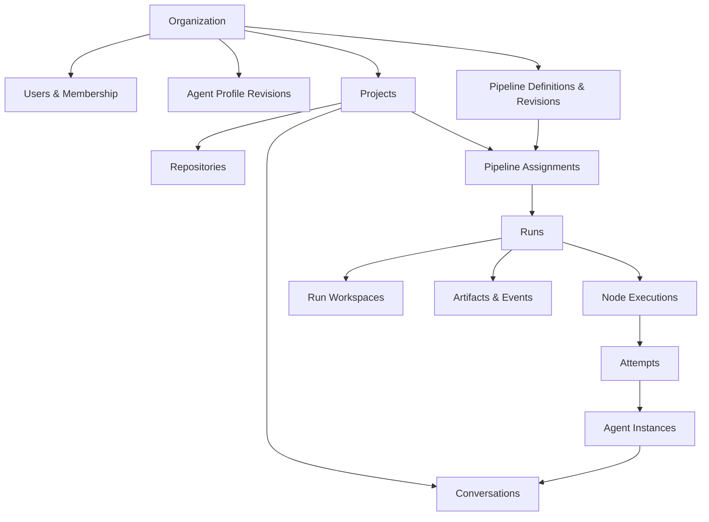
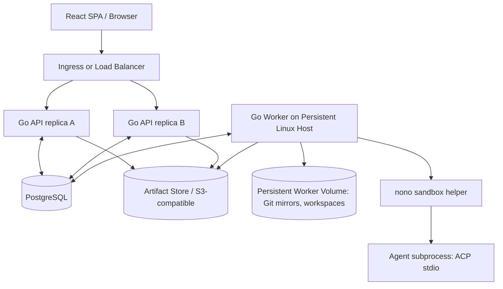
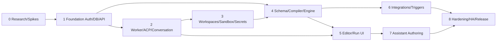

# Communication — Consolidated Architecture Specifications

Baseline: 2026-10-14. Provisional design contracts; read the packaged README and agent briefs for usage and authority.


---

<!-- BEGIN 00-product-vision.md -->

# 00 — Product Definition & Product Requirements

## Vision

Communication is a self-hostable, open-source **operating environment for AI-assisted software engineering teams**. It helps organizations codify their development philosophy, run agent-powered work with human oversight, share live context, and improve reusable processes based on execution evidence.

### Product principles

1. **Organizations own the recipes.** Do not prescribe a planning methodology, issue tracker, judge, vendor or merge process.
2. **Batteries included, not hard-coded.** Ship curated example pipelines for onboarding, feature implementation, bug fixing and dependency upgrades; each can be copied and edited.
3. **Conversation-first access; pipeline-powered work.** A user can start a one-off ACP conversation without creating a pipeline, or build recurring workflows and monitor many runs.
4. **Human and automation cooperate.** Inspect, pause, take control, correct, approve, return to automation, audit.
5. **Durability is honest.** User-visible progress and event history survive API restarts. Active agent process and uncheckpointed edits do not automatically migrate between hosts.
6. **Extensible by configuration.** Agent profiles, APM packages, node templates and reusable child pipelines should be authorable without rebuilding Go.
7. **Least authority.** Project authorization, scoped credentials and run sandbox limits; integration and assistant actions are permission checked.
8. **Open source interoperability.** Prefer mature protocols/SDKs (ACP, APM, OIDC, Git, OCI, JSON Schema) over proprietary replications; maintain adapter boundaries.

## Users / journeys

- **Factory maintainer** maintains agent launchers, APM packages, node templates, sandbox policies, pipeline revisions, limits; tests beta pipeline against one project before promotion.
- **Consultant / developer** oversees several projects, watches implementation/review runs, takes over a blocked agent conversation, returns control, files follow-up work.
- **Project lead** supplies broad planning input (text, uploaded document, speech transcript), initiates planning pipeline, reviews a draft spec, chooses task publication behavior.
- **Operator** manages broken workers, reclaims interrupted steps, investigates failed external actions, rotates credentials, verifies sandbox enforcement.
- **Personal user** runs the same software in a small environment, starts ad hoc conversations, schedules dependency-maintenance pipelines on own repositories.

## Illustrative lifecycle

1. Organization installs Communication and configures OIDC plus organization-managed agent credentials.
2. Operator creates a **Project** with frontend/backend repositories, authorized users, project secrets and workspace policy.
3. Factory maintainer chooses a sample `Feature Delivery` pipeline, copies it into a draft, assigns agent profiles/skills, tests, publishes revision `r1`.
4. Project assignment binds `r1` to manual starts, a schedule, or a GitHub issue filter, using project-specific inputs and concurrency.
5. A run begins with a multi-repo Run Workspace; planner produces a Markdown spec and structured `plan` output; human approves.
6. A `ForEach`/`InvokePipeline` step fans out implementation tasks with bounded concurrency. Each child run is independently inspectable/retriable.
7. Implementers modify isolated worktrees. Command checks and Codex/other review agents evaluate results; failures loop with feedback to the implementer.
8. A configurable publication stage commits/branches/pushes/opens PRs or merely leaves artifacts. Merge conflict work is its **own** reviewable pipeline (see Gas Town Refinery research).
9. User reviews live conversation, takes control, sends prompt, returns control; the run resumes under the published revision with a recorded intervention.
10. Factory maintainer asks Communication assistant to compare beta/stable performance and propose a **draft revision**. The assistant demonstrates edits in the UI; a human publishes/promotes it.

## Functional requirements (F = must for full v1 target, P = progressive)

| ID | Requirement | Priority |
|---|---|---|
| F-01 | Single trusted API control-plane server with multiple replicas behind a load balancer | F |
| F-02 | Long-lived Go worker mode that launches locally authenticated ACP agent subprocesses | F |
| F-03 | Project model with multiple repositories and project-scoped users/secrets/runs | F |
| F-04 | OIDC login and application RBAC with auditable authorization checks | F |
| F-05 | Human and pipeline-created durable conversations with ACP event streaming/history | F |
| F-06 | Take-control/return-control and explicit pause/cancel semantics | F |
| F-07 | Versioned pipeline graph, input schemas, node templates, failure routes, and child pipelines | F |
| F-08 | Manual runs, scheduled triggers, webhook/poll adapter foundation, bounded concurrency | F |
| F-09 | Agent node with ACP launcher and optional APM profile; command/LLM/condition/human gates | F |
| F-10 | Worktrees, per-run isolated writable workspaces, multi-repo layout | F |
| F-11 | PostgreSQL durable state, append-only operational event journal, artifact store | F |
| F-12 | Secrets injection including temporary `.env` generation, scoped use and cleanup | F |
| F-13 | Sandbox adapter with nono prototype, capability diagnostics and required-isolation failure | F |
| F-14 | Natural-language app assistant with typed tools, UI navigation and user-choice questions | F |
| F-15 | Example workflow gallery; clone/edit/validate/run; visual definition/live-run views | F |
| F-16 | YAML import/export and optional Git-backed workflow deployment | F |
| P-01 | First-party GitHub Issues/PR adapter with webhook/polling and idempotency | P (early) |
| P-02 | Object-store-backed cross-host workspace checkpoint recovery | P (later) |
| P-03 | Distributed Kubernetes pod workers and autoscaling | P (later) |
| P-04 | Communication MCP server/CLI made available to arbitrary agents | P (later; opt-in) |
| P-05 | Dynamic self-rewriting of an active pipeline | Explicitly not required |
| P-06 | Full visual analytics / pipeline A/B experiment suite | P (later) |

## Nonfunctional requirements

- Auditable, deterministic schedule choices; exactly one **current owner** for node attempt, not exactly-once external side effects.
- Capability-aware ACP integration (without uniform-resume assumptions); worker registration and heartbeat.
- No secrets or raw provider credentials in UI logs, events, config exports, or sample fixtures.
- Avoid a dependency on Kubernetes to run local development or a single-worker deployment.
- New setup: dev convenience mode starts Postgres (via compose), API, worker and embedded React app; production permits multiple independent API replicas.
- All consequential design choices documented as ADRs; compat/security smoke tests run against real providers in a controlled environment.

## Explicit design trade-offs

- No internal replacement for GitHub Issues/Beads/Linear: work item adapters expose external identity while Communication tracks **execution**.
- A completed agent session is not equivalent to feature delivered: success criteria and **publication** are configurable steps.
- Graphs are an authoring/execution view, not the sole navigation metaphor. Users also work from projects, conversations, run timelines and a backlog.


<!-- END 00-product-vision.md -->


---

<!-- BEGIN 01-domain-model.md -->

# 01 — Domain Model and Ownership Boundaries

## Vocabulary

| Object | Definition / cardinality | Source of truth |
|---|---|---|
| Organization | Top-level installation tenant / shared policy, members, agents and pipelines | PostgreSQL |
| User | Internal user mapped to OIDC `(issuer, subject)` pair; optional groups | PostgreSQL + IdP |
| Project | Logical work boundary: several repositories, members, secrets, assignments, artifacts | PostgreSQL |
| Client | Optional label/grouping, never mandatory for non-consultancies | PostgreSQL |
| Repository | Git remote and canonical mirror metadata, belongs to project (optional multi-project grants later) | PostgreSQL + Git |
| Workspace | **Concrete filesystem** for one run or conversation; several repo checkouts/worktrees and scratch | Worker filesystem + DB metadata |
| Agent Profile | Versioned configuration: launcher, model preference, prompts, APM dependency, limits, allowed secrets/sandbox | PostgreSQL / YAML |
| Agent Instance | A particular launched subprocess and negotiated ACP connection; transient | Worker process + DB metadata |
| Conversation | Durable human-visible message/event stream; may predate/outlive an ACP instance | PostgreSQL + artifacts |
| ACP Session Binding | Agent-provided session ID, protocol version, capabilities, owning worker, resume metadata | PostgreSQL |
| Node Template | Reusable parameterized typed node, versioned; may wrap agent/command/etc. | PostgreSQL / YAML |
| Pipeline Definition | Logical reusable flow identity | PostgreSQL |
| Pipeline Revision | Immutable canonical validated graph, input/output schemas, node bindings, references | PostgreSQL and optionally Git |
| Pipeline Assignment | Binding of revision/channel, project, trigger(s), parameters, budgets, rollout controls | PostgreSQL |
| Run | Pinned execution of a pipeline revision against inputs and project | PostgreSQL |
| Node Execution | Runtime invocation of a node (may occur many times in loop/fan-out) | PostgreSQL |
| Attempt | Particular start/retry of a node execution; lease, evidence and logs | PostgreSQL |
| Work Item Reference | External issue/Bead/Linear ID + adapter metadata, not a second issue tracker | PostgreSQL + source service |
| Artifact | Persistent typed binary/text object with ownership, storage URI, hash, sensitivity | Object store + PostgreSQL metadata |
| Secret Reference | Project/org secret descriptor and access policy; value never serialized to pipeline | Encrypted secret store / managed provider |
| Event | Sequenced append-only record describing a significant state change | PostgreSQL |
| Approval | Durable human decision request/result with actor, scope and deadline | PostgreSQL |

## Ownership rules

- A **Conversation** may have no pipeline, be attached to a run, or be transferred out of a completed run. Human control rights are tracked separately from its originating node.
- An **Agent Instance** belongs to exactly one worker process lifecycle. The agent's native ACP session can be restored only when advertised and supported; Communication's conversation history remains separately authoritative.
- A **Run** pins a revision at start; it must not start executing subsequently edited node definitions. One-off overrides are recorded as immutable run-local changes.
- A **Project** is the primary application authorization boundary. Its repository/workspace/credential mounts can be narrower than general membership.
- **Agent Profile** revisions also pin per attempt, including resolved APM lockfile digest and effective launch options.
- A **Run Workspace** can contain multiple repository checkouts; default isolation allocates a new workspace per run / writable parallel branch. Workspaces may be persistent but not automatically portable.
- Node **outputs** are JSON-serializable, schema-validated machine data; **artifacts** are separately stored documents, reports, screenshots, patches and binary outputs.
- **Client** is an optional grouping, not equal to Project or permission boundary.
- Publication actions (commit, push, PR, merge) are explicit pipeline nodes; the scheduler never silently pushes or merges.

## Principal relationships



## Authorization matrix — initial policy proposal

| Capability | Org admin | Project maintainer | Project contributor | Project viewer |
|---|---:|---:|---:|---:|
| View project/conversations/artifacts (non-sensitive) | via membership / policy | Yes | Yes | Yes |
| Create conversations and manual runs | via membership / policy | Yes | Yes | No |
| Prompt / take control of active session | governed by explicit control lock | Yes | Yes | No |
| Approve human gates | only designated approvers | configurable | configurable | No |
| Edit project assignment | Yes | Yes | Optional | No |
| Publish shared pipeline revision | Yes | only with library role | No | No |
| Manage project credentials / sandbox policy | Yes | optionally | No | No |
| Read raw secret value | No UI endpoint by default | No UI endpoint | No | No |

**Important:** This is an application authorization matrix. It does not mean that project members may safely share a Unix UID or a nono-only host when handling mutually untrusted clients. See security design.

## State machines

**Pipeline revision:** `draft → validated → published → deprecated/archived`; published content immutable. Failed validation remains draft.

**Run:** `queued → preparing → running → {waiting_human, paused, completed, failed, cancelled, interrupted}`. Waiting/pause may transition back to running; interrupted may transition to retry queue or terminal failure according to policy. `completed` means configured acceptance passes, not necessarily merged.

**Node execution:** `pending → ready → leased → running → {succeeded, failed, skipped, waiting, cancelled, interrupted}`. Repeated attempts append, not overwrite; retry returns execution to ready with new attempt.

**Conversation:** `active`, `idle`, `disconnected`, `archived`; orthogonal `controller={factory_run, human:user_id, none}` protected by optimistic version/CAS.

## Event lineage

Minimum correlation fields: `organization_id`, `project_id`, `run_id`, `node_execution_id`, `attempt_id`, `conversation_id`, `worker_id`, `revision_digest`, `actor_id`, `event_seq`, `trace_id`, `occurred_at`. Not every event uses every ID. Store old/new state and policy/decision evidence without leaking secrets.

## Invariants to turn into DB constraints / tests

1. Every run references exactly one immutable published revision and project.
2. A conversation can never have two simultaneously valid exclusive controllers.
3. Worker lease fencing token must monotonically increase per node attempt ownership transfer.
4. A `succeeded` attempt has validated outputs; a `failed` attempt may contain diagnostic outputs but cannot masquerade as a business gate failure.
5. No secret material is persisted in pipeline YAML, event payloads or generic node outputs.
6. All references in a graph point to unique node/template/revision IDs, not positional indices or UI coordinates.


<!-- END 01-domain-model.md -->


---

<!-- BEGIN 02-system-architecture.md -->

# 02 — System Architecture, Deployment and Durability

## Recommended deployment topology

Compile **one Go binary** with multiple modes:

- `communication serve`: HTTP API, OIDC, authorization, assistant tool gateway, SSE/event feeds, pipeline definition service, schedule enqueuer; horizontally replicated.
- `communication worker`: registers, heartbeats, claims execution attempts, owns repositories/workspaces, launches sandboxed ACP/command subprocesses; **independent rollout and lifetime**.
- `communication dev`: dev-only convenience orchestration for one API + one worker + frontend in one process; explicitly **not** an HA runtime.
- `communication migrate`, `communication doctor`: schema management and environment/ACP/APM/nono capability diagnostics.



**No distributed migration of live ACP subprocesses.** A worker may drain; API pods can roll without terminating worker processes. Multiple workers may exist once workspace locality and scheduling are ready; the initial production recipe can have 2–3 API replicas, one persistent worker.

## Go package boundaries — proposal

`cmd/communication`, `internal/domain`, `internal/authz`, `internal/pipelines/schema`, `internal/pipelines/compiler`, `internal/pipelines/runtime`, `internal/scheduler`, `internal/worker`, `internal/agent/acp`, `internal/agent/apm`, `internal/sandbox`, `internal/workspace/git`, `internal/secrets`, `internal/integrations`, `internal/events`, `internal/api`, `internal/assistant`, `internal/artifacts`, `ui/`.

Repository layout (ADR-0007, accepted 2026-10-14): one Go module at the repository root. Go code lives only in `cmd/communication` and `internal/…`. `ui/` is the Vite + React + TypeScript SPA, embedded into the binary via a small `ui` Go package; `api/` holds the OpenAPI document and the event JSON Schemas from 09 plus the `serve`-mode compose fragment, with Go request handlers staying in `internal/api`; `worker/` holds the worker container image, sandbox policy files, the agent launcher registry and the worker compose fragment, with Go worker code staying in `internal/worker`. `api/` and `worker/` are not Go modules.

Enforce dependency direction: domain and public interfaces contain no runtime SDK types; adapters depend on those interfaces. Avoid direct database calls from React action handlers or ACP callbacks without transactional application services.

### Key interfaces (conceptual, not final signatures)

```go
// A scheduler grants a fenced claim to exactly one worker at a time.
type ExecutionClaimer interface { Claim(ctx context.Context, workerID string, capacity int) ([]Claim, error) }
type AgentRuntime interface { Start(ctx context.Context, spec AgentLaunchSpec) (AgentHandle, error) }
type SandboxLauncher interface { Probe(ctx context.Context) (Capabilities, error); Launch(ctx context.Context, policy SandboxPolicy, cmd CommandSpec) (ProcessHandle, error) }
type WorkspaceStore interface { Prepare(ctx context.Context, spec WorkspaceSpec) (WorkspaceHandle, error); Recover(ctx context.Context, ref CheckpointRef) (WorkspaceHandle, error) }
type SecretResolver interface { Materialize(ctx context.Context, refs []SecretRef, destination SecretDestination) (Cleanup, error) }
type ArtifactStore interface { Put(ctx context.Context, input ArtifactInput) (ArtifactRef, error); Open(ctx context.Context, ref ArtifactRef) (io.ReadCloser, error) }
```

## Scheduling and recovery

- Postgres is the source of truth. On claim: transaction locks candidate rows with `FOR UPDATE SKIP LOCKED`, checks global/project/assignment capacity, writes `worker_id`, `lease_expires_at`, `fencing_token`, transitions attempt to `leased`, commits. Unique job keys prevent duplicate logical scheduling.
- Heartbeats renew leases; worker writes events/results with fencing token; stale owners' writes are rejected. `SKIP LOCKED` is a queue mechanism, **not** exactly-once external processing.
- A reconciler detects expired leases. It marks attempts `interrupted`, inspects any persisted workspace/checkpoint/external action records and decides retry/backoff/escalation.
- External actions use idempotency/reconciliation records. Example: check whether a PR for branch + operation ID already exists before retrying `create_pr`.
- Event rows and state transitions commit atomically; a transactional **outbox** may deliver notifications to clients/webhooks. SSE consumers reconnect with `Last-Event-ID` and replay from durable sequence; LISTEN/NOTIFY is only a wake-up optimization.
- Large streaming transcripts/terminal output should be batched to event store with redaction and bounded retention; artifacts in separate blob store.

## Execution recovery semantics

| Failure | Guaranteed | Not guaranteed |
|---|---|---|
| API pod restart | Browser reconnect, state persists, workers continue | An in-flight browser action may need idempotent retry |
| Worker graceful rollout | Stop claiming; drain or cancel per deadline; persist state | Transparent transfer of live stdio connection |
| Worker process restart on same persistent volume | Reconcile workspaces and retry/attempt ACP resume where supported | Mid-turn transcript or partial file edits are guaranteed intact |
| Worker host lost | Retry from last **portable** checkpoint/base Git revision if available | Recovery of uncommitted edits on lost disk |
| DB failover | Reconnect and reconcile leases | Exactly-once calls to GitHub or external APIs |

**Checkpointing:** at node boundaries, persist inputs/outputs and Git identifiers/manifest of changed paths; optional internal Git refs/bundles for portable checkpoints must be policy-controlled and must exclude ignored secrets. Initial worker-local workspaces are durable on a persistent volume. Cross-host rehydration is a separate implementation gate; do not advertise it before a shared artifact/checkpoint backend exists. Users accept redoing the incomplete node.

## Data / infrastructure plan

- Postgres for domain models, definitions, immutable revision JSON, run state, events, scheduler claims, authorization grants and audit data. Add forward-only SQL migrations and backwards-compatible deploy strategy (`expand → deploy → backfill → contract`).
- S3-compatible artifact store **recommended for deployed multi-replica APIs**; dev fallback to local filesystem; avoid storing multi-MB logs in database rows.
- Persistent worker directory on dedicated volume for Git mirrors and workspaces; do not mount it into API pods.
- OIDC provider for user login; application-level sessions in secure HTTP-only cookies; worker service identity isolated from browser identities.
- Container/Kubernetes deployment **supported**, not required for local runtime. Sandbox helper must be smoke-tested in the actual deployment environment.

## Service availability scope

Multiple API replicas provide **control-plane rolling update availability**. One worker remains an execution single point of failure, one PostgreSQL instance remains a DB failure domain, and local-only workspaces are host-bound. Describe these honestly in deployment docs.

## Observability

OpenTelemetry trace context across API → scheduler → worker → agent attempt where possible, with bounded tracing and redaction. Metrics: queued/running/waiting attempts, lease expiry, sandbox enforcement failures, ACP handshake failures, retry loops, agent duration, trigger ingestion lag, external-action reconciliation, artifact bytes, user handoff latency. No prompt/raw secret fields as metric labels.


<!-- END 02-system-architecture.md -->


---

<!-- BEGIN 03-pipeline-engine.md -->

# 03 — Pipeline Definition Language and Execution Engine

## Design requirements

A visual graph, YAML file, and assistant-created draft are **three authoring surfaces for one canonical versioned pipeline representation**. Pipeline logic is organization-defined; the scheduler only knows execution state/dependencies/capacity. The published definition remains immutable for the duration of a run. A pipeline may create child pipeline runs, but it may not arbitrarily rewrite its own published graph.

### Definition versus runtime graph

- **Definition graph:** unique node IDs, explicit directed dependencies, typed JSON inputs/outputs, parameter expressions, policy, node templates, UI layout metadata (non-semantic).
- **Runtime graph:** a tree/DAG of node executions, loop iterations and spawned child pipeline runs. One definition node can produce thousands of execution attempts. Never replicate them into the published definition.
- **Loops:** explicit `until`/`for_each` composite scopes with limits and nested acyclic graphs; do not allow unrestricted back-edges. `parallel` and `join` are scopes/controls.
- **Composite outputs:** `until`, `for_each`, and `pipeline.invoke` expose declared result bindings scoped to their child executions; for example an `until` result may map the successful last-iteration reviewer evidence to its `summary` output.
- **Publish result:** pipeline output bindings evaluated at successful terminal state; failures include error envelope and partial artifacts.

## Standard node catalogue

| Node kind | Inputs / outputs | Notes |
|---|---|---|
| `agent.acp` | prompt, profile, context, workspace → structured output, conversation ref, artifacts | Start fresh or resume existing session by declared policy; ACP capabilities negotiated |
| `model.chat` | messages, model/provider, JSON schema → text/JSON | OpenAI-compatible endpoint, no ACP process |
| `process.exec` | executable, argv, cwd, environment references → exit, stdout/stderr artifact, JSON extraction | No free-form shell expansion by default |
| `condition` | CEL expression over outputs/run context → route key | Evaluate bounded, deterministic expression, no filesystem access |
| `gate` | judge/check/human decision → `pass|fail|indeterminate` + evidence | Convenience template over agent/model/command/human; distinguish execution error |
| `human.approval` | artifact/context, approvers, deadline → decision, comments | Durable wait; no worker slot held |
| `until` | nested subgraph + termination predicate → final result/iterations | Maximum iterations/duration mandatory; failures not implicitly “false” |
| `for_each` | array + nested subgraph → indexed result list | Configurable max in-flight and failure aggregation |
| `parallel` / `join` | branch scopes → collected results | Join modes `all`, `any`, `quorum` (quorum later if untested) |
| `pipeline.invoke` | pipeline revision + mapped inputs → child run ref/results | Child run has own lifecycle and retries; parent defines wait policy |
| `artifact.publish` | content/path → artifact ref | MIME, sensitivity, hash, retention |
| `git.commit`/`git.publish` | workspace/repo refs → commit/branch/PR refs | Explicit, idempotent/reconciled side effects |
| `integration.query` / `integration.action` | adapter and typed arguments → JSON | GitHub first; other backends follow provider contract |

**Reusable node templates** are authored wrappers over built-in node kinds, parameterized and versioned. E.g. `Security Reviewer` is `agent.acp` plus APM review profile, prompt, schema, workspace read-only policy, accepted error handling. Templates must not silently bypass sandbox/credential policies.

## Canonical document & schema

Provisional API version: `communication.dev/v1alpha1` (name to settle in ADR). YAML is the **portable text representation**; server stores parsed canonical JSON with normalized ordering and content hash. JSON Schema governs shape and user-defined data contracts; hash excludes purely visual layout metadata only if a stable canonicalization ADR says so. No embedded Python or arbitrary executable JS in YAML.

Sample in `examples/feature-development.yaml`. A simple draft schema is in `schemas/pipeline.schema.json`. It is **illustrative, not frozen**.

### Bindings and expressions

- Inputs are declared as JSON Schema. UI renders form fields from schema and sensible widgets.
- Outputs from nodes are arbitrary JSON objects with optional JSON Schema. Built-in examples: `plan`, `review_result`, `test_result`.
- Binding syntax: `${{ inputs.goal }}` and `${{ nodes.plan.outputs.plan }}` as ergonomic presentation; internally compile to a structured expression AST.
- For routing/expression evaluation, use a deliberately restricted **CEL** subset (e.g., `nodes.review.outputs.approved == true`), with allowlisted functions and budgeted evaluation; never evaluate Go templates with method access or arbitrary code.
- JSON Schema validation runs on inputs and produced outputs before downstream readiness; errors can route via node-level failure edges.
- Binary content travels by `artifact_id`; filesystem content by `workspace_ref + relative_path`, never path strings outside an authorized workspace.
- Status result envelope per node: `{execution_status, business_outcome, outputs, artifact_refs, workspace_ref, conversation_ref, diagnostics}`. `execution_status=success` with `business_outcome=fail` is common for tests/reviewers; engine exceptions are different.

## Scheduling semantics

1. Compile and validate revision: unique IDs, DAG scopes, no orphan/invalid ports, no recursive child invocation without bounded depth, valid secret refs, no secret literals, valid resource limits, valid schemas, reachable terminal outcomes.
2. Start run: persist immutable revision digest, effective assignment inputs, policy snapshot, resource budget, starting repository refs.
3. Determine ready nodes from dependency satisfaction; claim using Postgres scheduler and workspace affinity.
4. Materialize minimum required workspace/secret/agent package context; execute attempt; append stream events.
5. Validate results and checkpoint at node boundary. Evaluate routes and queue downstream nodes, wait for human, or advance loop/child scopes.
6. When all required terminal branches resolve, compute pipeline outputs, collect artifacts, mark completed/failed/cancelled.

**Concurrency:** limits layered `installation → organization → project → pipeline assignment → run → node/fanout`. User-selected 10-way fan-out is supported if resource quotas allow; sensible default proposed 3. Fairness should avoid one project monopolizing workers.

**Failure policy per node:** `stop`, `retry` (max count, backoff/jitter, retriable codes), `continue` (explicit failed envelope), `route` to named error branch; timeout and cancellation treated separately. An invalid condition is an execution error, not a business fail. Avoid infinite automatic retries of external side effects.

**Pause/Cancel/Take control:** pause stops future scheduling (and optionally asks agent to yield); cancel sends ACP cancellation if available followed by process-group termination on timeout; human takeover relinquishes factory session controller lock while the factory run waits, and return-control queues a continuation with recorded human intervention context.

**Checkpoint rules:** after success of each step preserve durable outputs/events, artifacts, repository base + resulting refs and relevant portable checkpoint metadata. For an interrupted active step, retry from previous completed boundary. Avoid snapshotting on every token/tool call.

## Runtime edge cases to test

- `for_each` of zero items; maximum fan-out; one child fails while siblings pass.
- Parent cancelled with 12 children; policy chooses cascade or detach; detached child is still visible.
- `until` reaches max iterations or accepts a condition that always returns indeterminate.
- Review agent returns malformed JSON; do not silently interpret as pass.
- Retry node uses `resume_session` but provider has no capability; configured fallback is `new_session` or fail.
- Shared writable workspace explicit option races with concurrent writers; require warning and workspace-exclusive lock for unsafe node kinds.
- UI graph edited after run start: existing run remains pinned to original revision.
- Run-local node override changes only that retry; emits `run.override.applied` event with actor, before/after and reason.

## Publication and merge

`Implement` produces code in workspace; **not automatically a PR/merge**. Ship optional sample pipelines: `Commit Branch`, `Create Draft PR`, `Verify Merge Candidate`, `Resolve Conflict`, `Merge With Approval`. Gas Town's Refinery (verification gates, batch-and-bisect merge queue) is **research inspiration**, not a required feature in initial scheduler. Prefer PR-based protected branch workflows as the default example; orgs choose alternatives.


<!-- END 03-pipeline-engine.md -->


---

<!-- BEGIN 04-agent-runtime.md -->

# 04 — Agent Runtime, ACP and APM

## Responsibilities

Communication is an ACP **client** that owns the subprocess environment, prompts, permission UX, cancellation, and durable event capture. The ACP agent owns its own native session implementation. Do not equate its session with Communication's persisted conversation record.

## ACP protocol baseline

- Start against **documented v1 behavior**; v2 is a draft and should be behind explicit adapter/feature flags.
- JSON-RPC 2.0 over declared transport; stdio first. `initialize` capability negotiation, optional authentication, `session/new`, optional `session/load` in v1, `session/prompt` plus streamed `session/update`, `session/cancel`, permission requests; v2 session resume semantics are different. See official sources in research notes.
- Browser never talks directly to ACP subprocess. Worker translates protocol events into canonical `ConversationEvent` and can serve raw debug protocol capture only to authorized operators, subject to redaction.
- Implement `Client` methods for permission resolution, optional files/terminal hooks if negotiated, and structured elicitation where negotiated. Capability matrix is specific to launcher and version.
- Retain raw-ish protocol content for diagnosis only when allowed by privacy policy; normalized event history is durable primary record. Tool call IDs and update order must be stable and deduplicated.
- Stop reasons, streaming chunks, tool calls, plan updates, rate/usage signals where available map to typed events. Unknown extensions remain opaque and do not crash the client.

## Agent launcher registry

Registry entry: `id`, display name, executable + argv (no shell expansion), supported platform, ACP protocol version(s), process env policy, per-harness auth requirements, APM target, known limitations, health-check procedure, compatibility test status.

Examples **not guaranteed launch commands** until verified by probe: Codex ACP adapter, Claude Code ACP adapter, Gemini ACP. A launcher may call an npm/npx command pinned to an exact version; `npx latest` at runtime is prohibited in reproducible worker profiles. Verify availability and licensing/subscription support as part of the compatibility lab.

Credential source should be **organization-managed and terms-compliant** (API key, supported token, or correctly provisioned harness login). Don't assume personal interactive CLI subscriptions permit multi-user shared service usage. Auth must be distinguishable from application OIDC.

## Profile → environment → instance

**AgentProfileRevision** contains `launcher_ref`, `apm_package_ref`, `apm_lock_digest`, `system_instructions`, `model_preference`, `workspace_mode`, `sandbox_policy_ref`, `secret_refs`, `limits`, `permission_mode`, `resume_mode`, `failure_fallback`. Distinguish `harness_default`, `managed`, and `managed+overrides` modes.

The worker creates a prepared staging directory to install/compile APM **before** agent launch, pins dependency versions, targets the selected harness, and records manifest/lock digest. Generated skills/MCP/config files must be visible to the agent as required by that harness. APM preparation is **not itself isolation**, and target-native config semantics are not uniform.

Avoid modifying shared user home or source repo by default. Some harnesses can read only config from standard user/repo paths: probe for compatibility; if necessary, copy generated files into the **per-run checkout** with explicit cleanup and exclusion or isolated HOME. Do not promise strong per-session APM isolation until tested per launcher.

### Session reuse semantics

`new`: launch fresh agent/session on current workspace; pass goal and prior evidence.

`resume_if_supported`: if compatible version/cwd/session ID and agent advertises `loadSession` (v1) or appropriate v2 capability, attempt restore; on failure follow explicit `fallback: new | fail` policy.

`continue_live`: loop targets still-connected ACP session; one exclusive controller at a time; feedback prompt sent only after prior turn ends.

A completed pipeline node may leave conversation `idle` and **release to a human**, even after the originating run finishes; reattachment creates a new agent instance/binding if old process exited.

## Permission policy

Configurable per profile: `ask`, `preapproved_within_sandbox`, `deny` (also configurable by tool/action). Agent can be given broad freedom inside a constrained sandbox, but **auto-approving ACP prompts is not a substitute for sandbox isolation**. Permission requests create events and durable prompts to authorized users; no hanging forever without deadline/fallback.

## Go library adoption

Candidate: `github.com/coder/acp-go-sdk` for typed Go ACP, but evaluate current schema version alignment, streaming cancellation, and helper lifecycle in `M0 ACP compatibility spike`; avoid committing to specific library APIs in persisted domain schemas. Prefer SDK over reimplementing JSON-RPC and maintain an `AgentRuntime` interface.

## Agent compatibility lab

Test each candidate with real harness and disposable repo:

1. Installed launch and authentication preflight (non-interactive scenario where possible).
2. `initialize` and capability matrix; v1/v2 negotiation.
3. New session; prompt; token/tool/permission streaming; terminate.
4. Two consecutive prompt turns; cancellation during tool call.
5. Session reload/resume after process restart, with same and different workspace paths.
6. Read/write behavior in multi-repository checkout; optional additional directories.
7. APM package prepare with two different skills/MCP sets; isolation between sessions.
8. Restart with interrupted output; malformed ACP data and broken pipes.
9. Sandbox and credential operation; verify no secret leak in normalized events.

Publish a generated matrix (`docs/compatibility/ACP.md`) per adapter version. An agent may be `launchable`, `streaming`, `resumable`, `permission-capable`, etc. Never claim universal support on the basis of ACP branding alone.


<!-- END 04-agent-runtime.md -->


---

<!-- BEGIN 05-workspaces-security-secrets.md -->

# 05 — Repositories, Sandboxes, Credentials and Secrets

## Workspace design

Each **Project** has zero or more associated Git repositories. Each **Run Workspace** is a worker-local directory e.g. `/var/lib/communication/workspaces/<run-id>/` with stable subdirectories for several checkouts:

```
run-482/
  repos/frontend/     # dedicated linked worktree or clone
  repos/backend/      # dedicated linked worktree or clone
  scratch/            # generated documents, temporary outputs
  meta/               # worker-only metadata, never mounted to agent
```

- Default writable parallel branches create **separate Run Workspaces** or scoped forked worktrees; reviewers may share immutable input/checkpoint without sharing writable directories.
- Optionally, a user may explicitly select a **shared writable** workspace with concurrency/race warnings and locking; not default.
- Treat repo mirrors (`/var/lib/communication/repos`) as worker-managed; linked worktrees require shared Git common metadata—**a copied worktree alone is not portable**.
- The workspace root is always resolved/normalized server-side. Reject traversal, symlink escape, relative paths used as ACL proof. Agent's working directory and additional repo paths are logical configuration, not security enforcement.
- Configurable workspace creation from branch/ref + per-repo policy. Do not automatically push/merge changes.
- Test data / generated artifacts go under scratch or dedicated paths, not silently into tracked repositories.

## Checkpoint/recovery policy

At successful node boundaries save: repo HEAD/base refs, dirty diff summary, output JSON, artifact references, modified path manifest, ACP conversation pointer. Worker-local persistent volume preserves actual edits across worker process restart on same host. For cross-host recovery, **only** portable staged checkpoints (internal Git bundle/ref or captured diff + allowlisted untracked files in object storage) can recreate prior edits. Never include ignored secret files or runtime credential homes in checkpoint payload. No continuous filesystem snapshot promise; user accepts retrying an interrupted node.

## Sandbox backend — nono first prototype

Define `SandboxPolicy{fs_ro, fs_rw, fs_deny, network, process, resources, ipc, required_level}` and `SandboxCapabilities`. `SandboxLauncher` starts **child** processes; NEVER install irreversible Landlock restrictions in the main API/worker Go process.

**nono prototype** on a modern Linux host (kernel ABI probe) with CLI/helper execution. Compare to Bubblewrap/OCI for later. Nono uses kernel Landlock restrictions; its early-development security policy explicitly says it is not a separate kernel/microVM boundary and production use is not currently recommended. Use behind a configurable enforcement mode:

- `required`: abort when filesystem/network/IPC guarantees cannot be verified; only mode acceptable for production security claims.
- `permissive-dev`: run a clearly labeled insecure development execution if configured by administrator; never silently fallback.
- `disabled`: explicit admin-only for trusted local developer use; every event carries isolation status.

**Trust caveat:** users' Project membership does not imply separate Unix/credential isolation. Two mutually untrusted client projects should require stronger outer isolation (distinct Unix identity / OCI or VM / separate worker credential scope) before asserting tenant security. nono is an additional layer, not a certification of tenant safety.

Security test cases: filesystem traversal/symlink, inherited FDs, `/proc`, Unix sockets, Docker/Podman sockets, HOME XDG paths, SSH agent/GPG agent, Git credential helpers, network allowlist and DNS bypass, child process inheritance, terminal helpers, credential mount, nested container environment. Test actual `nono` status/reporting on each supported host image.

## Secrets / credentials design

Three independent concepts:

1. **User identity (OIDC)** — who uses Communication.
2. **Project/organization integration credentials** — GitHub Apps/PATs/SSH deploy keys, external APIs, DB secrets, etc.
3. **Harness authentication** — credentials needed to start Claude/Codex/etc. under organization-approved terms. These can be sensitive directory trees, not necessarily a single environment variable.

**SecretRef:** `scope (project|org)`, `secret_id`, `version`, `allowed_agent_profiles`, `allowed_node_templates`, `purpose`, `delivery_mode (env|file|integration_broker)`, audit policy. Store encrypted at rest with envelope KMS/provider key when available; local dev fallback with explicit master key outside DB. Avoid UI view-raw-secret endpoint and never log secrets.

### `.env` materialization

Support declared secret placement when an app/test needs `.env` at a specific path within a checkout:

```yaml
secret_mounts:
  - secret: project/test-database-url
    mode: env_file
    repository: backend
    relative_path: .env.test.local
    key: DATABASE_URL
    lifecycle: node_attempt
```

**Contract**: only allow relative paths under an authorized workspace checkout; validate after resolving symlinks; ensure required file mode (0600), owner-only readable, atomic creation; refuse overwriting a tracked file by default; verify `git ls-files` and check ignore/exclude rules; remove at attempt completion; exclude materialized paths from Git staging/checkpoints/artifacts/diff previews; rotate/revoke and rematerialize on retry. Do not claim secure deletion on SSD/copy-on-write filesystems. If a file must live in a tracked path, require an explicit policy exception, not a silent overwrite. Never include generated `.env` content in conversation logs or artifacts.

**Threat-model clarification**: an agent granted read access to `.env` can copy/exfiltrate its contents over any allowed channel. Secret scoping and network egress control matter more than file permissions alone. For third-party credentials prefer a restricted broker/token over long-lived raw secrets where feasible. Treat redaction as a defense-in-depth best effort, not absolute secrecy after an agent has seen a value.

## Publish / merge responsibilities

A workspace's successful implementation result is a candidate change. Configure separate commands/nodes for commit, push, draft PR, human review and merge. Gas Town's Refinery design motivates an optional *merge queue with verification and batch bisection*; it does not force auto-merge into the core executor. External publication operations need idempotent tokens and post-crash reconciliation.

## First security acceptance gate

- `communication doctor` prints kernel/nono version, isolation verdict, forbidden capabilities, run-user permissions and expected attack surfaces.
- In test sandboxes, agent can read/write allowed workspace but cannot read another project checkout or configured denied credentials, or use blocked egress/socket routes in enforcement configuration.
- On missing kernel feature or policy mismatch, the run fails with a visible security error; no implicit unprotected execution.
- `.env` materialization test: file exists only within desired attempt, excluded from `git status`/tracked changes and stored artifacts, no value exposed in logs; traversal attempts rejected.


<!-- END 05-workspaces-security-secrets.md -->


---

<!-- BEGIN 06-collaboration-identity.md -->

# 06 — Identity, Collaboration and Audit

## Identity architecture

Use OIDC Authorization Code + PKCE through a well-maintained Go/OIDC library. Store internal `user_id` mapped to immutable `(issuer, subject)` identity, not email address as key. Optionally map IdP groups to roles through explicit policy. Initial simple hierarchy: organization admin; project maintainer/contributor/viewer; library publisher; approver. People may be members of multiple Projects; Client is not a role.

API authentication: secure HttpOnly same-site cookie, CSRF protection for browser mutations, strict origin checks for event transports. Worker authenticates as machine/service identity and can access only its assigned secret refs and jobs, never rely on end-user browser tokens for background work.

Authorization MUST be checked at application service boundaries for read/write, WebSocket/SSE subscriptions, artifact downloads, assistant tools, and external integrations. Project-scoped identity claims cannot be trusted just because an ID is present in a URL or node input. Consider row-level security in Postgres as defense-in-depth after query scoping is established.

## Shared conversation model

A conversation is a durable object consisting of human messages, assistant streams, tool calls, approval prompts, event links and annotations. It has exactly one **active controller** while automation/humans can be multiple viewers. The controller is acquired via compare-and-swap against `conversation_control.version` and is owned by `run_attempt`, `user`, or `none`. A second human cannot prompt an actively factory-controlled ACP session until control is explicitly transferred.

**Human takeover sequence**

1. Authorized user selects `Take control`; API checks project membership and active controller.
2. Running factory node enters `waiting_human` at a safe boundary; if needed sends ACP cancellation and waits for turn acknowledgement. Do not send competing prompts to a running turn.
3. Controller changes atomically to user, emits `conversation.control.transferred` with actor, reason, previous owner, target owner.
4. Human prompts, edits workspace (if permitted); Communication appends events to durable conversation and associates workspace changes.
5. `Return to factory` releases user control, records summary/evidence and queues continuation according to declared profile `resume_if_supported | new_with_context | fail`. Agent sees exactly the human change summary and current workspace state.

**Human gate** is different from takeover: it may simply request approval/rejection and release worker resources until the decision arrives. Deadlines and escalations are policies.

## Permission and secrecy

Permission prompts arriving from ACP are surfaced to **authorized current controller** or designated approvers. Default sample workflows may auto-approve agent edits only *within an enforced sandbox*, never universally grant file/network access. Sensitive transcripts and artifacts may be further labeled `internal`, `restricted` or `secret` and filtered from viewers without corresponding access; plain project membership does not imply viewing raw secrets (no raw secret UI ever).

Session shares are internal links under RBAC; do not expose unauthenticated public share URLs by default. Every action is audit logged: attempts to view out-of-scope resources, handoffs, approvals, agent profile changes, secret materializations (reference only), sandbox bypass policy changes, integration token use, releases and pipeline promotions.

## OIDC edge cases

- User removed from project while observing an SSE stream: stream should cease delivery and connection terminate or reauthorize on short-lived window.
- Identity provider unreachable: existing sessions follow configured short-lived grace for read-only views; no new privileged sessions.
- Two people click Take Control simultaneously: exactly one wins CAS; loser sees current owner.
- Admin publishing shared pipeline from assistant: must use identical permissions/approval path as manual UI.
- Worker running with organization-managed credentials cannot be treated as the browser user's personal login; record initiating actor separately from effective execution identity.

## Audit and retention

All significant events append with actor (`human`, `system`, `agent`, `integration`), effective authorization context, correlation IDs and timestamp. Operational events are tamper-evident through permissions + optional chained digests; do not assert cryptographic tamper proof if not implemented. Provide retention/deletion strategy for transcripts, artifacts, client data, credentials, OIDC PII and compliance requests. Allow project administrators to set event redaction/retention within system minimums for security audit.


<!-- END 06-collaboration-identity.md -->


---

<!-- BEGIN 07-config-integrations.md -->

# 07 — Configuration, GitOps and Integrations

## One schema, multiple editors

A pipeline definition is validated using `apiVersion/kind/metadata/spec` plus referenced JSON Schema contracts. Primary authoring surfaces:

1. Browser graph editor (draft changes via typed mutation API).
2. YAML import/export (stored separately or in Git).
3. Communication assistant (same typed mutations with UI navigation and diffs).

**Postgres** is the operational store for drafts, published immutable revisions and assignments. **Git** is an optional declarative source/target, never a second competing live mutable copy. Record import/export direction, commit SHA, origin, schema version and content digest. Incoming Git changes produce candidate draft/revision and conflict information; do not silently overwrite an active published definition. Organization may choose `database` or `git-managed` governance policy, but every execution is pinned to an immutable revision in Postgres.

Schema migrations: explicit converter functions across `v1alpha1 → v1beta1` etc. Reject unknown dangerous enum values; preserve extension namespaces. Provide lint/validate/diff/format commands and dry-run import before actual publication.

### Reusable assets

- **Agent Profile:** versioned runnable ACP/model settings + APM reference/lock digest.
- **Node Template:** versioned parameterized wrapper over built-in node kind; generic templates are installable as organization assets.
- **Pipeline:** graph, nodes and inputs, may invoke other pipeline revisions.
- **Pipeline Assignment:** project-specific trigger, parameters, version/channel policy, concurrency, secret refs and authorized users.
- **Starter Gallery:** read-only bundled examples with descriptive “what it does”, minimum prerequisites, and `Clone to organization` action.

## Trigger/query/action provider contract

**Trigger** emits an event used to start pipelines or enqueue invocations (manual, cron-like schedule, webhook, polling).

**Query** reads external state and returns typed JSON (e.g. list GitHub issues matching label).

**Action** performs external side effect (create issue, comment, push branch, create PR, close issue), with idempotency key + probe/reconcile function where possible.

This does **not** create a second generic issue tracker. Communication owns run invocations/backlog; GitHub/Beads/Linear own their issue data.

### Initial GitHub adapter

- Manual repo URLs/local registered Git repos first; GitHub GitHub App or scoped installation token preferred for service-owned webhook/API, rather than OAuth granting all of a user's GitHub privileges.
- Repository enumeration via integration credential when available; optional user OAuth later for convenience.
- Filter issues by labels/states/assignee; webhook signature verification; event dedupe by delivery ID; periodic polling reconciliation; trigger idempotency tuple `(project, assignment, external_item, revision/window)`.
- Work item metadata `provider`, `external_id`, `canonical_url`, `etag/update_marker` and minimal cached fields, not authoritative issue body.
- For action retries: transactionally record intent with operation ID, check whether external resource exists (e.g. PR for branch) before repeating. Exactly-once effects cannot be assumed.
- Publish node suite: create commit/branch, push to permitted remote, draft PR, comment/update/close issue; each independently permissioned.

### Other adapters

Define public provider interfaces so Beads, Linear, Jira and others can be contributed without coupling scheduler to task semantics. The start template can simply accept a free-text goal/markdown plan; no issue integration is mandatory.

## Example library to ship

1. **Plan → Human approve → Implement → Run tests → Review → Loop until pass → Create draft PR.** Demonstrates human gates, ACP profiles and explicit publication.
2. **Process ready GitHub issues** at maximum `N` concurrent; trigger/poll query, `for_each`, invoke child implementation pipeline, preserve child observability.
3. **Dependency maintenance:** scheduled inspect/update/tests/review pipeline; default creates a draft PR, never merges automatically.
4. **One-off cross-repo investigation:** ad hoc ACP conversation against multi-repo workspace (no pipeline needed).
5. **Alternative reviewer experiment:** clone stable revision to beta, switch model/profile, assign only one Project; collect metadata for later comparison.

## Version rollout

On publish, assign immutable semantic version and content digest. Projects pin exact revision by default. Promotion of a new revision is an explicit action (per-project or bulk) with preview of affected assignments. Optional channels `stable`/`beta` resolve to a pinned revision **at new run creation**, and current runs remain pinned.

## Budget/limit layers

System quotas bound concurrency, CPU, memory, disk, run duration, loop count, child pipeline depth and recursion. Assignment/project may request lower limits. If usage/cost telemetry is supplied by a provider, store it for visibility but do not assume all agents report equivalent token/billing data.


<!-- END 07-config-integrations.md -->


---

<!-- BEGIN 08-assistant.md -->

# 08 — Communication Assistant and Agent-Native Interaction

## Product behavior

Communication's built-in assistant can inspect project/runs/conversations, explain failures, construct draft pipelines, configure node templates and agent profiles, navigate users through UI, and ask structured open-ended questions. It is an **application agent**, not merely a chat pane. Its authority is derived from the authenticated user's permissions and policy approvals.

**Open-ended user choices:** allow `assistant.question` responses composed of explanatory text, meaningful phrase-option buttons, free text, optional file selection, and follow-up. Selecting `Run both reviewers in parallel` becomes that literal semantic answer, not an opaque button index. Questions are persisted as conversation events and remain understandable in history.

### Structured application tools

`project.list`, `project.open`, `pipeline.list`, `pipeline.inspect`, `pipeline.createDraft`, `pipeline.cloneRevision`, `pipeline.addNode`, `pipeline.updateNode`, `pipeline.connect`, `pipeline.validate`, `pipeline.diff`, `pipeline.publish`, `assignment.previewPromotion`, `run.inspect`, `run.pause`, `run.retry`, `conversation.open`, `conversation.takeControl`, `artifact.inspect`, `nodeTemplate.createDraft`, `agentProfile.inspect`, `ui.navigate`, `ui.focus`, `ui.highlight`, `question.ask`, `approval.request`.

Functions above are **proposed domain action names**, not currently implemented API routes. App assistant and human UI must invoke the same permission-checked application services; tools should never manipulate raw Postgres tables. Validation includes project scope, actor authorization, version preconditions, confirmations and auditable mutation records.

### Tool action policy

- Read-only inspection may proceed within user's authorized scope.
- Draft modifications can be applied with real-time visual highlighting and undo/history.
- Publishing, changing project access, starting high-cost runs, changing secrets/security policy, destructive actions or pushing/merging code require explicit confirmation and elevated permission as appropriate.
- Agent must never possess Communication administration tools by default **inside ordinary coding ACP sessions**. An optional future Communication MCP server/CLI may expose project-scoped capabilities to explicitly opted-in agent profiles.
- UI navigation is **presentation** of an already authorized state/API operation, not brittle DOM-click automation.
- Interactive workflow: propose → show diff + relevant consequences → user approves → mutate/publish → audit event; UI should distinguish draft changes from published effective behavior.

### Example interaction

User: “For Project A only, try the Codex reviewer in parallel with Claude and cap each issue at four review loops.”

Assistant: inspects the assignment and current revision, clones draft, updates parallel and until scopes and parameters, renders visualization highlighting changed nodes, asks: **“Do you want this beta used for new issues only, or also replace pending queued invocations?”** with phrase buttons, validates and shows rollout preview. Publishing still requires approval.

### Event protocol to UI

Structured assistant events include `assistant.message.delta`, `assistant.tool.proposed`, `assistant.tool.executing`, `assistant.tool.completed`, `assistant.question`, `assistant.ui.navigate`, `assistant.ui.focus`, `assistant.diff.ready`, `assistant.approval.required` (all correlated to assistant conversation/turn ID). UI handles them as typed commands with safe targets, not arbitrary executable frontend scripts.

### Reasoning / improvement analytics

Assistant may analyze event history from last 30 implementation runs to identify review loops, bottlenecks, flaky tests and high manual intervention. Recommendations should cite internal run/event IDs and separate observed facts from LLM interpretation. It creates drafts, **never autonomously deploys a new workflow** absent explicit policy/user approval.

## Model backing

Use configurable OpenAI-compatible endpoint for direct chat/model calls, or dedicated ACP runtime if selected. Separate application assistant role/credentials from project coding agent profiles. Persist assistant transcript and action trace; redact privileged data. Speech-to-text is a client input modality, not a new assistant backend contract.

## UI design non-negotiables

- Show what agent is changing (node highlight, diff, affected projects) without requiring a fancy cinematic animation.
- One control source for actions (UI and assistant call same API).
- Structured choice prompts may contain user-defined phrase buttons, multi-selection where appropriate and free text.
- Render artifacts (Markdown, HTML preview, images) in a sandboxed viewer with sanitization and restrictive iframe `sandbox`/CSP; never execute untrusted HTML as the app's origin.
- “Who changed this and why?” must be answerable for every assistant mutation.


<!-- END 08-assistant.md -->


---

<!-- BEGIN 09-api-events-data.md -->

# 09 — API, Event and Persistence Contracts

This document specifies **proposed** public API conventions, not an already deployed server. Freeze details after the first vertical slice and ADR.

## HTTP APIs (suggested)

Use versioned `/api/v1` JSON endpoints. Authorization always project/org scoped. Operations creating work accept `Idempotency-Key`; resources include `etag/version` for conditional updates; adopt problem+json-compatible errors.

| Resource | Examples |
|---|---|
| Identity/project | `GET /me`, `GET/POST /projects`, `GET /projects/{id}/repos`, `PUT /projects/{id}/members/{uid}` |
| Pipelines | `GET/POST /pipelines`, `POST /pipelines/{id}/drafts`, `POST /drafts/{id}/validate`, `POST /drafts/{id}/publish`, `GET /revisions/{digest}` |
| Assignments | `GET/POST /projects/{id}/assignments`, `POST /assignments/{id}/promote`, `POST /assignments/{id}/preview` |
| Runs | `POST /runs`, `GET /runs/{id}`, `POST /runs/{id}:pause`, `:resume`, `:cancel`, `:retry`, `GET /runs/{id}/nodes` |
| Conversations | `POST /conversations`, `GET /conversations/{id}`, `POST /conversations/{id}/messages`, `/take-control`, `/return-control` |
| Profiles/assets | `GET/POST /agent-profiles`, `/node-templates`, `/secrets` (metadata-only) |
| Artifacts | `GET /artifacts/{id}` with signed controlled download; HTML previews through separate sandbox origin |
| Assistant | `POST /assistant/conversations`, `POST /assistant/{id}/messages`, typed tool and question response APIs |
| Ops | `GET /system/health`, `/system/readiness`, `/workers`, `/compatibility`, `/audit` |

Do not make browser API accidentally expose worker internal service endpoints. Worker claims through DB in the initial implementation; direct worker API, if added, requires mutual authentication and short-lived authorization.

## Durable event envelope

```json
{
  "event_id": "evt_01...",
  "global_seq": 152007,
  "type": "node.attempt.completed",
  "schema_version": 1,
  "occurred_at": "2026-10-14T18:00:00Z",
  "organization_id": "org_1",
  "project_id": "project_4",
  "run_id": "run_482",
  "node_execution_id": "ne_5",
  "attempt_id": "attempt_2",
  "conversation_id": "conv_19",
  "actor": {"kind": "worker", "id": "worker_a"},
  "trace_id": "...",
  "payload": {"status": "succeeded", "result_ref": "result_42"}
}
```

Event types include `run.started`, `run.paused`, `run.interrupted`, `run.completed`, `node.attempt.started`, `node.attempt.failed`, `node.attempt.completed`, `agent.session.connected`, `conversation.message.*`, `conversation.tool.*`, `conversation.control.transferred`, `approval.requested/decided`, `secret.materialized` (**metadata only**), `sandbox.enforcement_failed`, `artifact.created`, `external_action.intent/reconciled`, `pipeline.revision.published`, `assignment.promoted`.

The event journal is **durable operational history**, not a mandate to reconstruct every read model from events (full event sourcing unnecessary). For each significant state transition: one SQL transaction updates authoritative state, appends event and outbox notification. Event retention/export supported.

## Database table families

- Auth: `organizations`, `users`, `oidc_identities`, `memberships`, `project_grants`, `service_identities`.
- Project: `projects`, `repositories`, `repository_credentials` (secret ref only), `project_settings`.
- Config: `pipelines`, `pipeline_drafts`, `pipeline_revisions`, `node_templates`, `agent_profiles`, `assignments`, `assignment_versions`, `config_git_sources`.
- Execution: `runs`, `run_inputs`, `node_executions`, `attempts`, `worker_leases`, `workers`, `run_checkpoints`, `pipeline_invocations`, `trigger_deliveries`, `external_action_intents`.
- Agent: `conversations`, `conversation_events`, `conversation_control`, `agent_instances`, `acp_session_bindings`, `agent_capability_snapshots`, `approval_requests`.
- Storage: `artifacts`, `secret_metadata`, `credential_grants`.
- Operations: `domain_events`, `outbox`, `audit_events`, `schedule_cursors`, `integration_credentials`.

### Constraints / indexes to prioritize

- `UNIQUE (issuer, subject)` for OIDC identity.
- Published revision hash unique in organization.
- `UNIQUE (run_id, node_instance_key, attempt_number)`; monotonic fencing token for attempt owner.
- External trigger dedupe `(assignment_id, provider, delivery_id)` and action op-id unique.
- `conversation_control` exactly one current owner with version CAS.
- Ordered `domain_events (project_id, global_seq)` pagination plus retention partitioning when needed.
- Every sensitive query includes project permission predicate, not a client-controlled header.

## Event streaming to browser

Recommend SSE initially for append-only events; interactive mutations remain HTTP POST. SSE reconnects from monotonically increasing durable `global_seq` / `Last-Event-ID` and catches up from DB. For high-frequency token deltas, worker may batch/coalesce to reduce DB costs, while preserving readable transcript order. Add WebSocket only for features truly requiring bidirectional low-latency channel. Ensure no event stream leaks inaccessible projects across subscriptions.

## Example interaction contracts

`POST /runs` accepts `pipeline_revision_id` or project assignment ref (resolved and pinned by API), typed inputs, workspace policy, idempotency key; returns `run_id`, `status=queued`, UI route.

`POST /conversations/{id}/take-control` requires current `version` and authorization, returns new controller/version or conflict.

`POST /drafts/{id}/publish` requires validated graph digest, publish permission and optional change approval, returns immutable revision and non-mutated assignments; promotion is separate.

`POST /runs/{id}:retry` takes target node execution/attempt and optional run-local input override, enforces checkpoint availability and explicit downstream invalidation, returns new attempt reference.


<!-- END 09-api-events-data.md -->


---

<!-- BEGIN 10-ui-design-handoff.md -->

# 10 — Functional UI/UX Design Handoff

**Audience:** separate product/design agent. This is not a request to code UI visuals. Design information architecture, interaction architecture, low/high fidelity screens, responsive layouts, states and design tokens; use backend contracts below without inventing engine semantics.

## Product positioning to communicate

“Communication is where a software team runs, supervises, shares, and improves AI-agent software workflows.” Avoid marketing it as merely a node graph editor. Prioritize **work awareness** (“what needs my attention?”), clear agent control and readable execution history.

## Navigation / information architecture (proposal, not visual mandate)

- Organization switcher / account / operational health.
- Projects index: activity, blocked runs, assigned users, repository list, active pipeline assignments, recent artifacts.
- Project detail: `Overview`, `Work/Queue`, `Runs`, `Conversations`, `Repositories`, `Pipelines`, `Artifacts`, `Settings`.
- Pipeline Library: searchable examples, organization-owned pipelines, drafts, stable/beta versions; node-template library, agent profile library.
- Pipeline editor: canvas, node palette, detail inspector, parameters, validations, revision diff, publish/promotion controls.
- Run inspector: definition graph view **vs** expanded runtime execution tree; timeline, attempts, loops, child runs, statuses, artifacts, source revision, human interactions.
- Conversation: messages/tool progress/permissions, participant presence, controller identity, takeover/return-control, workspace/diff, relevant run node.
- Assistant: global context-aware panel with typed action previews, UI focus/highlights, interactive phrase buttons, text follow-ups, approvals, undo drafts.
- Admin/Operations: workers, sandbox health, ACP/APM compatibility, project identities, credentials metadata, audit and rate limits.

## Key user journeys to design completely

**J1 — First-run onboarding:** admin connects OIDC (or approved dev auth), creates Project, adds two repositories, registers a managed Claude/Codex launcher/profile, imports starter pipeline, configures secrets, checks sandbox status, launches first run. Errors and prerequisites should not be hidden.

**J2 — New consultant assigned five projects:** lands on attention dashboard; identifies two stalled runs, one human approval, three conversations; opens relevant client project without finding locally installed skills; takes control of blocked session, prompts, returns control.

**J3 — Pipeline author creates workflow:** selects sample Plan→Approve→Implement→Review; changes agent profiles/inputs, adds a bounded review loop, validates; previews YAML/diff; publishes a new revision; promotes it to one Project only.

**J4 — Natural-language authoring:** user says “Use Gemini as reviewer for the beta of project A”; assistant inspects, navigates to correct canvas, highlights proposed nodes, asks meaningful option question; produces draft diff and rollout preview; user confirms publication.

**J5 — Live complex run:** pipeline definition has six nodes, `ForEach` expands to 25 children and hundreds of attempts. Show compact progress by stage and expandable child run tree. No visually tangled 150-node canvas by default.

**J6 — Permission request / handoff:** active ACP agent asks permission; current authorized controller sees decision with consequence; separate human takes control while factory waits; control returns with evidence.

**J7 — Failure/recovery:** worker disappears; run marks interrupted; user can see surviving checkpoint and what work may need to be repeated; choose retry or stop; don't display spurious “resumed without loss.”

**J8 — Secret settings:** configure secret by reference/masked input and target `.env` destination; show path/permission policy and warnings; never display raw secret in run inspector.

**J9 — Publication:** code review passes; branch/draft PR created as explicit step; PR/status/commit linked; user can identify what remains unmerged.

## Components/UX states to cover

- Pipeline node inspector inputs/outputs/schema bindings (`${{ nodes.plan.outputs.plan }}`), raw/output view, retry/failure routing and resource limits.
- Node templates browser (owner, version, compatibility, example outputs, clone/edit).
- Graph edges and nested scopes: until, foreach, parallel, invoke pipeline, human approvals, conditions, error routes.
- Agent profile settings: default harness, managed APM package, overrides, auth readiness, capabilities, sandbox and secret selection.
- Deployment status: assignment selects exact published revision / stable / beta with explicit preview before changing target Project.
- Workspace widget: repos, base refs, dirty changes, worktree identity, associated conversations, outputs/artifacts; no misleading “git restore” affordance.
- Activity timeline: events correlated by run/node/attempt; search/filter by failure, actor and stage.
- Assistant states: planning, asking, proposing typed tool action, executing, completed, failed, awaiting approval; show history of actions and route-target highlights.
- Empty and error states: no repos, no agent account, nono kernel unavailable, APM target mismatch, disconnected worker, missing portable checkpoint, expired worker lease, missing permission.
- Responsive behavior: desktop graph canvas; on mobile favor status/lists/conversation rather than forcing full graph editing.
- Accessibility: keyboard navigation/focus, screen-reader run hierarchy, transcript streaming rate, statuses never color-only, reduced-motion assistant highlighting.

## Interaction and backend rules the design MUST respect

- UI cannot decide scheduling/branch outcomes independently of server.
- Draft edits are not published until authorized; changing a Project assignment is a distinct action from publishing.
- Human conversation and pipeline-driven ACP conversation share a common presentation, but show controller/ownership clearly.
- Pausing the *pipeline* is different from interrupting an *agent turn* or taking control.
- A project's membership controls visibility; no cross-project data leakage through autocomplete/assistant.
- ACP capabilities vary per agent; buttons disabled/explained when resume/permissions/etc. unsupported.
- Secret values never displayed in transcript/diffs; generated untrusted HTML artifacts open in sandboxed preview, separate origin.
- Long-running assistant actions show meaningful intermediate progress and seek confirmation for privileged operations.

## Requested output from design agent

1. Sitemap, entity-navigation model and rationales.
2. User-flow diagrams J1–J9 and alternate/error paths.
3. Wireframes for project dashboard, conversation, pipeline library, editor, run inspector, assistant and operations.
4. Component inventory + interaction specs with keyboard/accessibility states.
5. Proposed design system (tokens/typography/layout) and responsive behavior.
6. Exact frontend/backend data dependencies for each screen/action and event subscriptions.
7. A small clickable prototype or annotated flows illustrating assistant “navigate, edit, ask question, apply” behavior.
8. UX acceptance checklist tied to the realistic consulting-team scenario.

## Independence boundary

The designer owns layout, branding, copy, progressive disclosure and navigation choices. The engineer owns state machines, protocol negotiation, sandbox policy, API auth, scheduling and durable storage. Design conflicts should be documented and resolved through a contract review, not silently worked around in frontend code.


<!-- END 10-ui-design-handoff.md -->


---

<!-- BEGIN 11-build-roadmap.md -->

# 11 — Implementation Game Plan and Dependencies

**Strategy:** Implement the complete architectural contract in independently testable vertical increments. Do not ask one coding agent to implement the entire vision without checkpoints. Design can be ambitious; milestones must produce shippable evidence. Every stage includes ADRs and tests. Parallel teams can build nonconflicting modules once domain/API contracts stabilize.

## Dependency outline



### M0 — Architecture/compatibility spike (**mandatory before framework commitment**)

- Create Go monorepo, CI, dependency/license auditing, ADR template, supported Linux images.
- Probe `coder/acp-go-sdk` against actual chosen Claude/Codex/Gemini ACP adapters, streaming, permission, cancellation, session restart.
- Probe APM `--target` + lockfile reproducibility and effective config isolation across two sessions.
- Probe nono within host, Docker and rootless Podman against filesystem/network/socket policies; fail-closed policy demonstrator.
- Validate worktree layouts for two repos and whether selected harness can work there.
- Record SDK/version selection and risks; create compatibility and sandbox capability matrices.

**Exit:** `communication doctor` proof-of-concept demonstrates at least one ACP agent end-to-end against disposable repo, no claims of all harness support.

### M1 — Core domain and HA-ready control plane

- PostgreSQL migrations, OIDC login, project and memberships, repository registrations, scoped authz, API versioning and event journal/outbox.
- `communication serve/worker/dev` command modes; health, readiness, migration compatibility.
- Multiple API replicas share DB and event history; force restart, show preserved events and user access.
- Simple embedded React shell/functional routes (design agent refines later).

**Exit:** log in, create project, add two repositories, see consistent state across two API replicas.

### M2 — Conversation-first agent supervision

- Agent profile registry; ACP worker client, launch, prompt, live SSE transcript, tool/permission events, durable history.
- Ad hoc conversation against a project workspace; controller lock, stop/cancel and restart behavior.
- Worker claims/leases/fencing; interrupted attempt events on worker termination.

**Exit:** user A starts Claude or Codex, user B observes permitted conversation and takes over/returns control; restart API pods without losing transcript.

### M3 — Workspace, secrets, sandbox and APM

- Multi-repo run workspaces, worktrees, concurrent isolation, worker volume identity.
- APM package staging for managed profiles; lock digests; default-vs-managed config modes.
- Secret references, project-scoped policies, env/env_file materialization, sandbox launch via nono, capability diagnostics and security tests.
- Artifact store abstraction, Markdown/images/HTML-report storage with safe preview.

**Exit:** separate project agent cannot access other project's declared denied workspace in tested enforcement profile; `.env` appears only at authorized path during attempt, absent from outputs and git artifacts.

### M4 — Workflow compiler, scheduler and engine

- Canonical v1alpha1 schema, graph validator, CEL binding subset, immutable revision store, JSON outputs + artifact refs.
- ACP agent / command / model / condition / human gate / until / for_each / parallel / child pipeline / explicit artifact and publication nodes.
- Node retry, branch failure, backoff, limits, durable attempts, node boundary checkpoints, child run bookkeeping and cancellation.

**Exit:** sample Plan→Approve→Implement→Test→Review→Loop completes on disposable repo with validated state after crash/retry.

### M5 — Usable visual application

- Project/run attention dashboard, pipeline library, draft editor, run timeline, expanded child-run tree, conversation UI, attempt detail and diff/artifacts.
- Node templates, agent profiles, assignment rollout UI and YAML viewer.
- Apply separate UI design brief; accessibility/error/recovery states.

**Exit:** an untrained test user clones and customizes sample pipeline, sees a stalled run, takes control, retries and views evidence.

### M6 — Integrations and configuration-as-code

- GitHub issue query/trigger/action adapter, webhook verification/poll reconciliation, first-party PR publication steps.
- YAML importer/exporter, optional Git repository-backed drafts and publish/import conflict UX.
- Schedule triggers and lightweight invocation backlog; explicit promotion stable/beta per project.

**Exit:** 3 ready issues produce at most N in-flight child runs; duplicate webhook does not duplicate logical work; draft PR action can reconcile after simulated crash.

### M7 — Application-controlling assistant

- Assistant conversations/tool broker, read/draft actions, UI event choreography, meaningful phrase questions, confirmation/approval policy.
- Natural-language flow editing produces validated draft and diff, then user approves publication; advanced run-analysis tools later in milestone.
- Speech-to-text as optional UI input to same assistant channel (not prerequisite for backend).

**Exit:** assistant changes only Project A assignment's beta review agent, highlights changes, asks user choice, shows exact diff and requires approval.

### M8 — Release quality / distributed-readiness

- Load test many projects and 25 child runs; worker drain; API rollout; Postgres restart recovery, artifact retention, backup and restore.
- Sandbox compatibility matrix, secret/redaction audit, threat model review and production limitations documented.
- Open-source docs: quickstart, Helm chart/container guide where supported, contributor guide, ADRs, support matrix and SECURITY.md.
- Decide portable checkpoints/multiple worker host execution and stronger isolation as separately gated release work.

**Exit:** end-to-end consulting-team scenario in test deployment with concurrent API replicas, one stable worker and real sample agents; honest recovery guarantees documented.

## ADR practices

Before implementing an irreversible contract, create ADR with context, considered alternatives, decision, consequences, rollback plan, links to tests/spikes. ADR topics: Go architecture, Postgres scheduler, ACP client SDK/v1-v2 support, APM staging, workspace locality, nono enforcement, OIDC/RBAC, pipeline schema/CEL, artifacts, secrets, assistant tool permission model, GitOps and integration idempotency.

## Suggested task slicing for coding agents

Use one issue/PR per coherent slice with concrete acceptance test; avoid concurrent edits to canonical schemas by multiple agents. A schema/contract owner reviews changes. Mock peripheral APIs only after at least one real compatibility test exists. Keep migrations forward/backward rollout safe. When agent cannot verify a runtime guarantee, log as spike and block release rather than inventing success.


<!-- END 11-build-roadmap.md -->


---

<!-- BEGIN 12-test-strategy.md -->

# 12 — Verification and Acceptance Plan

## Testing pyramid

- **Unit:** schema canonicalization, expression evaluation limits, DAG/scope compiler, state machines, quotas, RBAC policy, idempotency and lease fencing.
- **Property/fuzz:** YAML/JSON input parser, references, graph recursion/cycle check, secret path materialization, ACP event decoding, CEL/resource limits.
- **Integration:** Postgres transactions/outbox claims, artifact store, Git worktrees, OIDC test provider, webhook HMAC, APM install and nono launch.
- **Contract:** actual supported ACP adapters, v1/v2 capability fixture, agent profile effective environment, assistant typed tool schema.
- **E2E:** all user journeys, especially fresh team onboarding, shared sessions, human handoff, child runs and interruption.
- **Operational/security:** Linux sandbox escapes, worker kill/restart, multiple replicas, DB failover/reconciliation and backups.

## Protocol compatibility table (record test results, don't prefill PASS)

| Candidate | New session | Streaming/tool calls | Permission | Cancel | Native restore | APM target | Nono |
|---|---|---|---|---|---|---|---|
| Claude Code ACP adapter/version TBD | Test | Test | Test | Test | Test | Test | Test |
| Codex ACP adapter/version TBD | Test | Test | Test | Test | Test | Test | Test |
| Gemini ACP/version TBD | Test | Test | Test | Test | Test | Test | Test |
| Pi ACP adapter/version TBD | Test | Test | Test | Test | Test | Test | Test |

Each row requires exact executable version, commit/registry ref, OS, auth mode, protocol negotiated, logs (redacted), known limits and sign-off. Keep compatibility suite in CI where credentials available, with a gated integration nightly separate from hermetic unit suite.

## Failure and concurrency test cases

1. Start same logical run twice with same idempotency key; only one logical run exists.
2. Two workers simultaneously claim one ready attempt; only one valid fencing token can commit state.
3. Worker loses lease but process keeps running; stale attempt cannot publish success; reconciler determines cleanup.
4. API replica rolls during streaming; new connection resumes from event sequence with no unauthorized events.
5. Worker killed during ACP tool call; persist `interrupted`, determine retry route; redo incomplete node from prior valid checkpoint.
6. External create-PR succeeds then response lost; retries reconcile and never create a second PR for same operation.
7. `until` never passes: reaches declared bound, marks failed with full evidence; no infinite loop.
8. Child pipeline 3 of 25 fails; sibling results preserved; aggregate failure policy works; bounded fanout.
9. Human approval requested, approver loses project access, unauthorized approval denied.
10. Two humans take control simultaneously; exactly one wins, prior prompt turn is safely paused/cancelled.
11. Changed pipeline revision while existing run executes; run remains pinned to original graph.
12. `.env` file present in specified checkout path only during authorized attempt; not in Git changes, logs or artifact export.
13. Sandbox restriction unavailable in required mode; process does not start and event records enforcement reason.
14. APM package changes on remote; lock digest on existing attempt remains stable.
15. User not assigned Project B probes API/SSE/artifact/assistant search: all denied without metadata leak.
16. HTML artifact with script payload rendered in restricted sandboxed viewer, cannot access Communication origin/cookies.
17. Run across frontend + backend; modifying one checkout doesn't mutate another run's worktree unexpectedly.
18. Trigger webhook duplicate/out-of-order event and scheduled polling overlap; no duplicate child executions.
19. Migration rolling deploy (old and new API) preserves compatibility in supported migration window.
20. Worker restart on same volume recovers workspace; restart on different host without portable checkpoint clearly reports loss/redo.

## First complete acceptance scenario

Administrator creates `Customer Platform` Project with two repos, configures shared agent profiles (APM planner, implementer, reviewer), adds scoped test secret, imports sample feature pipeline, validates sandbox. Another user starts work from goal. Planner emits spec and request; authorized human approves. `for_each` generates at least three child tasks and launches at most two concurrent agents into separate worktrees. Tests and second-agent review fail once and succeed on retry. One person takes over a conversation and returns to factory. Publication creates draft PR/branch or configured artifact. After API rollout, history remains. Assistant clones pipeline beta and changes reviewer, previews diff, user confirms promotion **only to this Project**. Cross-project unauthorized viewer cannot read events/artifacts.

## Release gate criteria

- All required integration/security assertions have evidence and pass in declared supported deployment environment.
- No production “sandboxed tenant isolation” claim based solely on alpha nono.
- All critical ADRs accepted and current as implemented.
- API and worker graceful rolling deployment test passes without silently losing completed node state.
- Documentation states precisely which failure classes require rerun of interrupted node and what checkpoint recoverability is supported.


<!-- END 12-test-strategy.md -->


---

<!-- BEGIN 13-decisions-and-adrs.md -->

# 13 — Architecture Decisions, Risks and ADR Governance

## Decision register as of 2026-10-14

| ID | Decision | Status | Why / next step |
|---|---|---|---|
| D-001 | Product is an open-source AI-assisted software team operating environment | Accepted | Factory recipes are organization-owned |
| D-002 | Go binary with `serve`, `worker`, optional `dev` | Accepted | API replicas rollout independently from agent processes |
| D-003 | Postgres authoritative DB; event history durable | Accepted | Multi-replica control plane and recovery |
| D-004 | Project logical boundary with multiple repositories; run workspace is concrete filesystem | Accepted | Avoid repo=project conflation |
| D-005 | Versioned pipelines, project assignments, controlled promotions | Accepted | Experiment safely across projects |
| D-006 | ACP primary coding agent protocol, APM profile packaging | Accepted | Use adapters; test real clients |
| D-007 | Resume conversations outside pipeline, human takeover | Accepted | Collaboration first-class |
| D-008 | Per-run worktree by default; shared writable explicitly optional | Accepted | Avoid agent file races |
| D-009 | Node-boundary checkpoints, honest worker restart | Accepted | No continuous snapshots or magic failover |
| D-010 | OIDC mapping, project-level RBAC, scoped secrets | Accepted | Central company execution |
| D-011 | nono first Linux sandbox prototype, interchangeable provider | Provisional | Validate enforcement and alpha risk; fail closed in required mode |
| D-012 | REST + SSE for initial browser APIs, Postgres transactional outbox | Proposed | Measure high-volume streaming before committing |
| D-013 | CEL subset + JSON Schema + YAML as canonical authorable format | Proposed | Build parser/validation spike; freeze versioned contract |
| D-014 | Artifact store with S3-compatible production backend and dev local fallback | Proposed | Multi-replica access; retention policy |
| D-015 | Initial hosted OIDC provider / exact Go auth library | Spike required | Verify deployment and identity mapping |
| D-016 | ACP Go SDK choice / supported protocol versions | Spike required | Real compatibility test incl. resume |
| D-017 | APM profile layout and preparation staging | Spike required | Harness-native path support varies |
| D-018 | Separate publication/merge pipeline, no hidden auto-merge | Accepted | Org controls quality gates and branch policy |
| D-019 | Node template parameterization / child-pipeline invoke | Accepted | Composable organizational secret sauce |
| D-020 | No default MCP/CLI privileges for ordinary coding agents | Accepted | Future opt-in app tool access |
| D-021 | Strict network egress controls per execution | Provisional | nono capability, proxy options, safe defaults require test |
| D-022 | GitOps import/export no dual mutable truth | Proposed | Validate conflict/merge UX |
| D-023 | Assistant tools share backend authz; publish needs approval | Accepted | User agency and audit |
| D-024 | Object store vs worker-local portable Git checkpoint strategy | Open | First version can retry incomplete nodes; define cross-host guarantees |
| D-025 | Exact Project/organization trust model for separate clients | Open | App RBAC != OS isolation; threat model before production |

## Highest risks and mitigations

**R1—Shared credentials expose other projects:** separate OS/OCI identity and secret mounts by trust boundary; nono defense-in-depth, no production tenant guarantee until pen test/architecture proof. **R2—ACP resume variance:** adapter capability matrix, fallback fresh session with full prior evidence. **R3—Worker lost local changes:** meaningful node checkpoints and explicit portability policy. **R4—External action duplicate:** intent IDs and reconciliation. **R5—Complex graphs become impossible to debug:** versioned scopes, runtime expansion tree and stable event lineage. **R6—APM managed profile config collides with other agents:** staging and harness-specific integration tests. **R7—Unbounded cost:** quota layers, retry bounds and scheduling fairness. **R8—Assistant gains excess power:** app tool authorization + draft/publish separation + approval gates.

## ADR process

Folder: `docs/adr/`. Decisions require ADR when they affect protocol version, persistence schema, security boundary, deployment model, public API contract, licensing, or change-recovery semantics. Small local refactors do not need ADRs. Use identifiers `ADR-0001-...` and status `Proposed → Accepted → Superseded`.

Required template in [`adr/ADR-TEMPLATE.md`](adr/ADR-TEMPLATE.md). Each ADR includes context, decision drivers, alternatives, decision, positive and negative consequences, security considerations, test evidence, migration/rollback plan and external citations. New contradictions with this register require ADR plus explicit register update.


<!-- END 13-decisions-and-adrs.md -->


---

<!-- BEGIN 14-research-notes.md -->

# 14 — External Research and Integration Notes

**Research snapshot: October 14, 2026.** Sources may evolve. Each vendor/project capability must be revalidated at implementation time and pinned to tested versions in compatibility matrix/ADRs. This is a source map, not a claim of completed lab verification.

## ACP — first-party protocol and Go SDK

- [Official Agent Client Protocol overview (v1)](https://agentclientprotocol.com/protocol/v1/overview) — JSON-RPC, initialize, session/new, v1 optional session/load, session/prompt/update, cancellation, client permissions/file/terminal and elicitation. The official docs label v1 latest and v2 draft as of research.
- [Official ACP v2 draft session setup](https://agentclientprotocol.com/protocol/v2/session-setup) — changed/new resume semantics and additional directory capability negotiation. Treat as draft, not universal.
- [ACP schema/source repository](https://github.com/agentclientprotocol/agent-client-protocol) — normative documents/testing.
- [coder/acp-go-sdk](https://github.com/coder/acp-go-sdk) — candidate Go SDK with client examples and typed protocol; version and schema alignment must be checked before adoption.

**Finding:** Communication maintains a distinct durable conversation and ACP instance binding. `session/load`/`session/resume` cannot be promised for all launchers. Test tool/permission/terminal behavior for each adapter.

## APM — agent package manager

- [Microsoft APM repository](https://github.com/microsoft/apm) — package manager for skills, prompts, instructions, hooks, MCP and agent config; `apm.yml`, `apm.lock.yaml`, multi-harness targets.
- [APM manifest schema working draft](https://github.com/microsoft/apm/blob/main/docs/src/content/docs/reference/manifest-schema.md) — YAML 1.2 manifest and version/target behavior, evolving draft.
- [APM package installation](https://github.com/microsoft/apm/blob/main/docs/src/content/docs/consumer/install-packages.md) — target selection, `--frozen`, lock-based resolution and deployment of harness-native config.
- [APM first package guide](https://github.com/microsoft/apm/blob/main/docs/src/content/docs/getting-started/first-package.md) — project targets and generated layouts.

**Finding:** APM is the preparation/dependency plane and NOT an isolation or ACP control protocol. Project/user config path differences require per-harness staging tests. Do not hardcode APM schema into Communication pipeline schema.

## Linux isolation

- [nono GitHub](https://github.com/nolabs-ai/nono) — process sandbox designed for coding agents; Landlock-based Linux policy; CLI and library bindings.
- [nono security policy](https://github.com/nolabs-ai/nono/blob/main/SECURITY.md) — explicitly no separate kernel boundary, security guarantees still developing; production use not recommended at research date.
- [nono Landlock implementation note](https://github.com/nolabs-ai/nono/blob/main/docs/cli/internals/landlock.mdx) — ABI negotiation and kernel policy basics.
- [Landlock kernel documentation](https://docs.kernel.org/userspace-api/landlock.html) — kernel restricts process and descendants without granting new permissions; may not be enabled on every host.
- [Bubblewrap](https://github.com/containers/bubblewrap) — namespace/mount sandbox toolkit; useful fallback/reference for stronger filesystem namespace arrangements but nested-in-container behavior must be tested.
- [Anthropic sandbox-runtime](https://github.com/anthropic-experimental/sandbox-runtime) — Bubblewrap/Seatbelt policy reference; do not assume it is available or secure in all nested configurations.

**Finding:** Start with nono as explicitly provisional prototype; verify actual enforcement and reject required-mode runs if unsupported. For mutually untrusted client projects, separate outer identities/containers and tighten credential scope. Do not mistake application Project RBAC for Linux isolation.

## Workspaces / persistent state

- [Git worktree docs](https://git-scm.com/docs/git-worktree) — linked worktrees share common repository administration/object state; copying directory alone does not make portable snapshot.
- [PostgreSQL SELECT locking and SKIP LOCKED](https://www.postgresql.org/docs/current/sql-select.html) — skip locked rows helpful for multiple consumers of queue-like tables but offers inconsistent view, not exactly-once side-effect semantics.
- [React Flow / sub-flows](https://reactflow.dev/learn/layouting/sub-flows) — candidate graph UI rendering/editing library; not a workflow execution engine. Check license and accessibility/graph performance during design spike.

**Finding:** DB-driven scheduler/leases/outbox and workspaces are separate concerns. Worker-local disk restarts are recoverable, host-loss recovery needs portable checkpoint design. Running graph must be separately represented from static definition.

## Gas Town — inspiration only

- [Gas Town repository](https://github.com/gastownhall/gastown) — multi-agent workspace manager and Beads work tracking with persistent agent state.
- [Gas Town architecture design](https://github.com/gastownhall/gastown/blob/main/docs/design/architecture.md) — merge queue / **Refinery**: batch candidates, verification gates, bisect on failure.
- [Gas Town patrol details](https://github.com/gastownhall/gastown/blob/main/.claude/commands/patrol.md) — reviewer/merge workflow mechanics.

**Finding:** The user remembered “Refiner”; correct in Gas Town terminology is **Refinery**. Borrow its failure isolation and gates as a pipeline/template inspiration, not copyrighted prompt text or wholesale implementation. Validate license and attribution if copying code/templates; otherwise implement independently.

## To research before final package choices

- OIDC Go middleware and reverse-proxy identity flow; go module maintenance and session security.
- CEL Go evaluation library, JSON Schema validation library, YAML strict parsing and semantic-version migrations.
- `pgx`/database migrations, SQL job/lease patterns, outbox/event SSE design.
- GitHub App permissions and webhook signature/dedupe; idempotent PR creation.
- Actual ACP launchers and organization credential terms/compatibility of Claude Code, Codex, Gemini and Pi.
- Artifact store encryption/retention, HTML iframe sandbox threat model, APM network package supply-chain verification.

## Source-vs-decision rule

Each proposed technology in these documents is either user-accepted, a research-backed candidate, or a spike item. External references describe source capabilities, **not** proof they meet Communication's intended use and security requirements. Implementation agent must write ADRs with reproducible local tests before converting provisional choices into production claims.


<!-- END 14-research-notes.md -->
