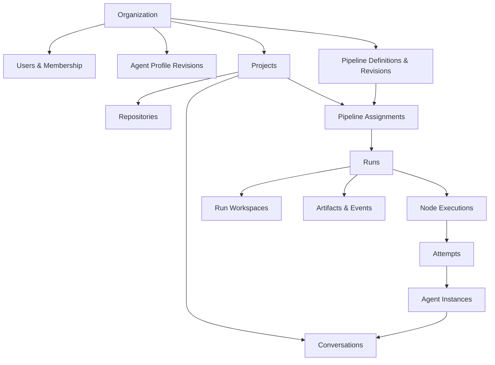

# 01 — Domain Model and Ownership Boundaries

## Vocabulary

| Object | Definition / cardinality | Source of truth |
|---|---|---|
| Organization | Top-level installation tenant / shared policy, members, agents and pipelines | PostgreSQL |
| User | Internal user mapped to OIDC `(issuer, subject)` pair; optional groups | PostgreSQL + IdP |
| Project | Logical work boundary: several repositories, members, secrets, assignments, artifacts | PostgreSQL |
| Client | Optional label/grouping, never mandatory for non-consultancies | PostgreSQL |
| Repository | Git remote and canonical mirror metadata, belongs to project (optional multi-project grants later) | PostgreSQL + Git |
| Workspace | **Concrete filesystem** for one run or conversation; several repo checkouts/worktrees and scratch | Worker filesystem + DB metadata |
| Agent Profile | Versioned configuration: launcher, model preference, prompts, APM dependency, limits, allowed secrets/sandbox | PostgreSQL / YAML |
| Agent Instance | A particular launched subprocess and negotiated ACP connection; transient | Worker process + DB metadata |
| Conversation | Durable human-visible message/event stream; may predate/outlive an ACP instance | PostgreSQL + artifacts |
| ACP Session Binding | Agent-provided session ID, protocol version, capabilities, owning worker, resume metadata | PostgreSQL |
| Node Template | Reusable parameterized typed node, versioned; may wrap agent/command/etc. | PostgreSQL / YAML |
| Pipeline Definition | Logical reusable flow identity | PostgreSQL |
| Pipeline Revision | Immutable canonical validated graph, input/output schemas, node bindings, references | PostgreSQL and optionally Git |
| Pipeline Assignment | Binding of revision/channel, project, trigger(s), parameters, budgets, rollout controls | PostgreSQL |
| Run | Pinned execution of a pipeline revision against inputs and project | PostgreSQL |
| Node Execution | Runtime invocation of a node (may occur many times in loop/fan-out) | PostgreSQL |
| Attempt | Particular start/retry of a node execution; lease, evidence and logs | PostgreSQL |
| Work Item Reference | External issue/Bead/Linear ID + adapter metadata, not a second issue tracker | PostgreSQL + source service |
| Artifact | Persistent typed binary/text object with ownership, storage URI, hash, sensitivity | Object store + PostgreSQL metadata |
| Secret Reference | Project/org secret descriptor and access policy; value never serialized to pipeline | Encrypted secret store / managed provider |
| Event | Sequenced append-only record describing a significant state change | PostgreSQL |
| Approval | Durable human decision request/result with actor, scope and deadline | PostgreSQL |

## Ownership rules

- A **Conversation** may have no pipeline, be attached to a run, or be transferred out of a completed run. Human control rights are tracked separately from its originating node.
- An **Agent Instance** belongs to exactly one worker process lifecycle. The agent's native ACP session can be restored only when advertised and supported; Communication's conversation history remains separately authoritative.
- A **Run** pins a revision at start; it must not start executing subsequently edited node definitions. One-off overrides are recorded as immutable run-local changes.
- A **Project** is the primary application authorization boundary. Its repository/workspace/credential mounts can be narrower than general membership.
- **Agent Profile** revisions also pin per attempt, including resolved APM lockfile digest and effective launch options.
- A **Run Workspace** can contain multiple repository checkouts; default isolation allocates a new workspace per run / writable parallel branch. Workspaces may be persistent but not automatically portable.
- Node **outputs** are JSON-serializable, schema-validated machine data; **artifacts** are separately stored documents, reports, screenshots, patches and binary outputs.
- **Client** is an optional grouping, not equal to Project or permission boundary.
- Publication actions (commit, push, PR, merge) are explicit pipeline nodes; the scheduler never silently pushes or merges.

## Principal relationships

## Authorization matrix — initial policy proposal

| Capability | Org admin | Project maintainer | Project contributor | Project viewer |
|---|---:|---:|---:|---:|
| View project/conversations/artifacts (non-sensitive) | via membership / policy | Yes | Yes | Yes |
| Create conversations and manual runs | via membership / policy | Yes | Yes | No |
| Prompt / take control of active session | governed by explicit control lock | Yes | Yes | No |
| Approve human gates | only designated approvers | configurable | configurable | No |
| Edit project assignment | Yes | Yes | Optional | No |
| Publish shared pipeline revision | Yes | only with library role | No | No |
| Manage project credentials / sandbox policy | Yes | optionally | No | No |
| Read raw secret value | No UI endpoint by default | No UI endpoint | No | No |

**Important:** This is an application authorization matrix. It does not mean that project members may safely share a Unix UID or a nono-only host when handling mutually untrusted clients. See security design.

## State machines

**Pipeline revision:** `draft → validated → published → deprecated/archived`; published content immutable. Failed validation remains draft.

**Run:** `queued → preparing → running → {waiting_human, paused, completed, failed, cancelled, interrupted}`. Waiting/pause may transition back to running; interrupted may transition to retry queue or terminal failure according to policy. `completed` means configured acceptance passes, not necessarily merged.

**Node execution:** `pending → ready → leased → running → {succeeded, failed, skipped, waiting, cancelled, interrupted}`. Repeated attempts append, not overwrite; retry returns execution to ready with new attempt.

**Conversation:** `active`, `idle`, `disconnected`, `archived`; orthogonal `controller={factory_run, human:user_id, none}` protected by optimistic version/CAS.

## Event lineage

Minimum correlation fields: `organization_id`, `project_id`, `run_id`, `node_execution_id`, `attempt_id`, `conversation_id`, `worker_id`, `revision_digest`, `actor_id`, `event_seq`, `trace_id`, `occurred_at`. Not every event uses every ID. Store old/new state and policy/decision evidence without leaking secrets.

## Invariants to turn into DB constraints / tests

1. Every run references exactly one immutable published revision and project.
2. A conversation can never have two simultaneously valid exclusive controllers.
3. Worker lease fencing token must monotonically increase per node attempt ownership transfer.
4. A `succeeded` attempt has validated outputs; a `failed` attempt may contain diagnostic outputs but cannot masquerade as a business gate failure.
5. No secret material is persisted in pipeline YAML, event payloads or generic node outputs.
6. All references in a graph point to unique node/template/revision IDs, not positional indices or UI coordinates.
