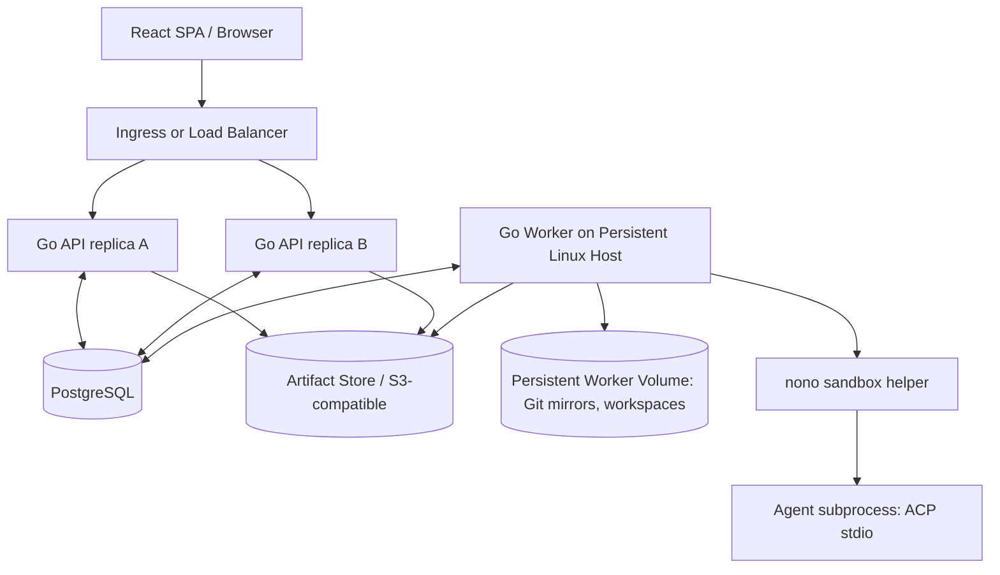

# 02 — System Architecture, Deployment and Durability

## Recommended deployment topology

Compile **one Go binary** with multiple modes:

- `communication serve`: HTTP API, OIDC, authorization, assistant tool gateway, SSE/event feeds, pipeline definition service, schedule enqueuer; horizontally replicated.
- `communication worker`: registers, heartbeats, claims execution attempts, owns repositories/workspaces, launches sandboxed ACP/command subprocesses; **independent rollout and lifetime**.
- `communication dev`: dev-only convenience orchestration for one API + one worker + frontend in one process; explicitly **not** an HA runtime.
- `communication migrate`, `communication doctor`: schema management and environment/ACP/APM/nono capability diagnostics.



**No distributed migration of live ACP subprocesses.** A worker may drain; API pods can roll without terminating worker processes. Multiple workers may exist once workspace locality and scheduling are ready; the initial production recipe can have 2–3 API replicas, one persistent worker.

## Go package boundaries — proposal

`cmd/communication`, `internal/domain`, `internal/authz`, `internal/pipelines/schema`, `internal/pipelines/compiler`, `internal/pipelines/runtime`, `internal/scheduler`, `internal/worker`, `internal/agent/acp`, `internal/agent/apm`, `internal/sandbox`, `internal/workspace/git`, `internal/secrets`, `internal/integrations`, `internal/events`, `internal/api`, `internal/assistant`, `internal/artifacts`, `web/`.

Enforce dependency direction: domain and public interfaces contain no runtime SDK types; adapters depend on those interfaces. Avoid direct database calls from React action handlers or ACP callbacks without transactional application services.

### Key interfaces (conceptual, not final signatures)

```go
// A scheduler grants a fenced claim to exactly one worker at a time.
type ExecutionClaimer interface { Claim(ctx context.Context, workerID string, capacity int) ([]Claim, error) }
type AgentRuntime interface { Start(ctx context.Context, spec AgentLaunchSpec) (AgentHandle, error) }
type SandboxLauncher interface { Probe(ctx context.Context) (Capabilities, error); Launch(ctx context.Context, policy SandboxPolicy, cmd CommandSpec) (ProcessHandle, error) }
type WorkspaceStore interface { Prepare(ctx context.Context, spec WorkspaceSpec) (WorkspaceHandle, error); Recover(ctx context.Context, ref CheckpointRef) (WorkspaceHandle, error) }
type SecretResolver interface { Materialize(ctx context.Context, refs []SecretRef, destination SecretDestination) (Cleanup, error) }
type ArtifactStore interface { Put(ctx context.Context, input ArtifactInput) (ArtifactRef, error); Open(ctx context.Context, ref ArtifactRef) (io.ReadCloser, error) }
```

## Scheduling and recovery

- Postgres is the source of truth. On claim: transaction locks candidate rows with `FOR UPDATE SKIP LOCKED`, checks global/project/assignment capacity, writes `worker_id`, `lease_expires_at`, `fencing_token`, transitions attempt to `leased`, commits. Unique job keys prevent duplicate logical scheduling.
- Heartbeats renew leases; worker writes events/results with fencing token; stale owners' writes are rejected. `SKIP LOCKED` is a queue mechanism, **not** exactly-once external processing.
- A reconciler detects expired leases. It marks attempts `interrupted`, inspects any persisted workspace/checkpoint/external action records and decides retry/backoff/escalation.
- External actions use idempotency/reconciliation records. Example: check whether a PR for branch + operation ID already exists before retrying `create_pr`.
- Event rows and state transitions commit atomically; a transactional **outbox** may deliver notifications to clients/webhooks. SSE consumers reconnect with `Last-Event-ID` and replay from durable sequence; LISTEN/NOTIFY is only a wake-up optimization.
- Large streaming transcripts/terminal output should be batched to event store with redaction and bounded retention; artifacts in separate blob store.

## Execution recovery semantics

| Failure | Guaranteed | Not guaranteed |
|---|---|---|
| API pod restart | Browser reconnect, state persists, workers continue | An in-flight browser action may need idempotent retry |
| Worker graceful rollout | Stop claiming; drain or cancel per deadline; persist state | Transparent transfer of live stdio connection |
| Worker process restart on same persistent volume | Reconcile workspaces and retry/attempt ACP resume where supported | Mid-turn transcript or partial file edits are guaranteed intact |
| Worker host lost | Retry from last **portable** checkpoint/base Git revision if available | Recovery of uncommitted edits on lost disk |
| DB failover | Reconnect and reconcile leases | Exactly-once calls to GitHub or external APIs |

**Checkpointing:** at node boundaries, persist inputs/outputs and Git identifiers/manifest of changed paths; optional internal Git refs/bundles for portable checkpoints must be policy-controlled and must exclude ignored secrets. Initial worker-local workspaces are durable on a persistent volume. Cross-host rehydration is a separate implementation gate; do not advertise it before a shared artifact/checkpoint backend exists. Users accept redoing the incomplete node.

## Data / infrastructure plan

- Postgres for domain models, definitions, immutable revision JSON, run state, events, scheduler claims, authorization grants and audit data. Add forward-only SQL migrations and backwards-compatible deploy strategy (`expand → deploy → backfill → contract`).
- S3-compatible artifact store **recommended for deployed multi-replica APIs**; dev fallback to local filesystem; avoid storing multi-MB logs in database rows.
- Persistent worker directory on dedicated volume for Git mirrors and workspaces; do not mount it into API pods.
- OIDC provider for user login; application-level sessions in secure HTTP-only cookies; worker service identity isolated from browser identities.
- Container/Kubernetes deployment **supported**, not required for local runtime. Sandbox helper must be smoke-tested in the actual deployment environment.

## Service availability scope

Multiple API replicas provide **control-plane rolling update availability**. One worker remains an execution single point of failure, one PostgreSQL instance remains a DB failure domain, and local-only workspaces are host-bound. Describe these honestly in deployment docs.

## Observability

OpenTelemetry trace context across API → scheduler → worker → agent attempt where possible, with bounded tracing and redaction. Metrics: queued/running/waiting attempts, lease expiry, sandbox enforcement failures, ACP handshake failures, retry loops, agent duration, trigger ingestion lag, external-action reconciliation, artifact bytes, user handoff latency. No prompt/raw secret fields as metric labels.
