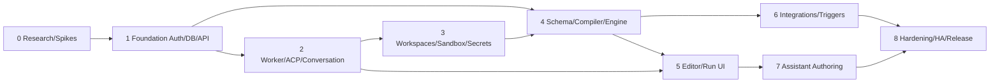

# 11 — Implementation Game Plan and Dependencies

**Strategy:** Implement the complete architectural contract in independently testable vertical increments. Do not ask one coding agent to implement the entire vision without checkpoints. Design can be ambitious; milestones must produce shippable evidence. Every stage includes ADRs and tests. Parallel teams can build nonconflicting modules once domain/API contracts stabilize.

## Dependency outline

### M0 — Architecture/compatibility spike (**mandatory before framework commitment**)

- Create Go monorepo, CI, dependency/license auditing, ADR template, supported Linux images.
- Probe `coder/acp-go-sdk` against actual chosen Claude/Codex/Gemini ACP adapters, streaming, permission, cancellation, session restart.
- Probe APM `--target` + lockfile reproducibility and effective config isolation across two sessions.
- Probe nono within host, Docker and rootless Podman against filesystem/network/socket policies; fail-closed policy demonstrator.
- Validate worktree layouts for two repos and whether selected harness can work there.
- Record SDK/version selection and risks; create compatibility and sandbox capability matrices.

**Exit:** `communication doctor` proof-of-concept demonstrates at least one ACP agent end-to-end against disposable repo, no claims of all harness support.

### M1 — Core domain and HA-ready control plane

- PostgreSQL migrations, OIDC login, project and memberships, repository registrations, scoped authz, API versioning and event journal/outbox.
- `communication serve/worker/dev` command modes; health, readiness, migration compatibility.
- Multiple API replicas share DB and event history; force restart, show preserved events and user access.
- Simple embedded React shell/functional routes (design agent refines later).

**Exit:** log in, create project, add two repositories, see consistent state across two API replicas.

### M2 — Conversation-first agent supervision

- Agent profile registry; ACP worker client, launch, prompt, live SSE transcript, tool/permission events, durable history.
- Ad hoc conversation against a project workspace; controller lock, stop/cancel and restart behavior.
- Worker claims/leases/fencing; interrupted attempt events on worker termination.

**Exit:** user A starts Claude or Codex, user B observes permitted conversation and takes over/returns control; restart API pods without losing transcript.

### M3 — Workspace, secrets, sandbox and APM

- Multi-repo run workspaces, worktrees, concurrent isolation, worker volume identity.
- APM package staging for managed profiles; lock digests; default-vs-managed config modes.
- Secret references, project-scoped policies, env/env_file materialization, sandbox launch via nono, capability diagnostics and security tests.
- Artifact store abstraction, Markdown/images/HTML-report storage with safe preview.

**Exit:** separate project agent cannot access other project's declared denied workspace in tested enforcement profile; `.env` appears only at authorized path during attempt, absent from outputs and git artifacts.

### M4 — Workflow compiler, scheduler and engine

- Canonical v1alpha1 schema, graph validator, CEL binding subset, immutable revision store, JSON outputs + artifact refs.
- ACP agent / command / model / condition / human gate / until / for_each / parallel / child pipeline / explicit artifact and publication nodes.
- Node retry, branch failure, backoff, limits, durable attempts, node boundary checkpoints, child run bookkeeping and cancellation.

**Exit:** sample Plan→Approve→Implement→Test→Review→Loop completes on disposable repo with validated state after crash/retry.

### M5 — Usable visual application

- Project/run attention dashboard, pipeline library, draft editor, run timeline, expanded child-run tree, conversation UI, attempt detail and diff/artifacts.
- Node templates, agent profiles, assignment rollout UI and YAML viewer.
- Apply separate UI design brief; accessibility/error/recovery states.

**Exit:** an untrained test user clones and customizes sample pipeline, sees a stalled run, takes control, retries and views evidence.

### M6 — Integrations and configuration-as-code

- GitHub issue query/trigger/action adapter, webhook verification/poll reconciliation, first-party PR publication steps.
- YAML importer/exporter, optional Git repository-backed drafts and publish/import conflict UX.
- Schedule triggers and lightweight invocation backlog; explicit promotion stable/beta per project.

**Exit:** 3 ready issues produce at most N in-flight child runs; duplicate webhook does not duplicate logical work; draft PR action can reconcile after simulated crash.

### M7 — Application-controlling assistant

- Assistant conversations/tool broker, read/draft actions, UI event choreography, meaningful phrase questions, confirmation/approval policy.
- Natural-language flow editing produces validated draft and diff, then user approves publication; advanced run-analysis tools later in milestone.
- Speech-to-text as optional UI input to same assistant channel (not prerequisite for backend).

**Exit:** assistant changes only Project A assignment's beta review agent, highlights changes, asks user choice, shows exact diff and requires approval.

### M8 — Release quality / distributed-readiness

- Load test many projects and 25 child runs; worker drain; API rollout; Postgres restart recovery, artifact retention, backup and restore.
- Sandbox compatibility matrix, secret/redaction audit, threat model review and production limitations documented.
- Open-source docs: quickstart, Helm chart/container guide where supported, contributor guide, ADRs, support matrix and SECURITY.md.
- Decide portable checkpoints/multiple worker host execution and stronger isolation as separately gated release work.

**Exit:** end-to-end consulting-team scenario in test deployment with concurrent API replicas, one stable worker and real sample agents; honest recovery guarantees documented.

## ADR practices

Before implementing an irreversible contract, create ADR with context, considered alternatives, decision, consequences, rollback plan, links to tests/spikes. ADR topics: Go architecture, Postgres scheduler, ACP client SDK/v1-v2 support, APM staging, workspace locality, nono enforcement, OIDC/RBAC, pipeline schema/CEL, artifacts, secrets, assistant tool permission model, GitOps and integration idempotency.

## Suggested task slicing for coding agents

Use one issue/PR per coherent slice with concrete acceptance test; avoid concurrent edits to canonical schemas by multiple agents. A schema/contract owner reviews changes. Mock peripheral APIs only after at least one real compatibility test exists. Keep migrations forward/backward rollout safe. When agent cannot verify a runtime guarantee, log as spike and block release rather than inventing success.
