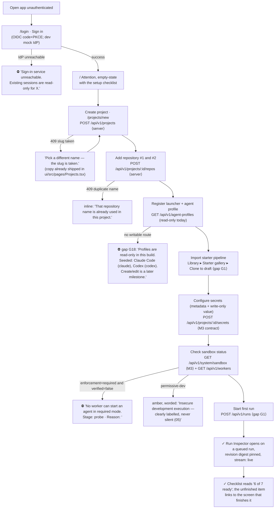
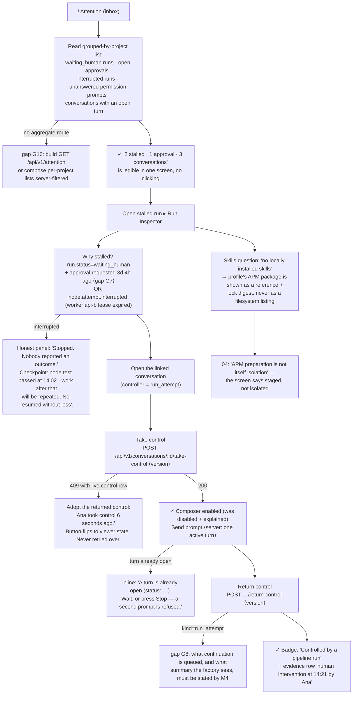
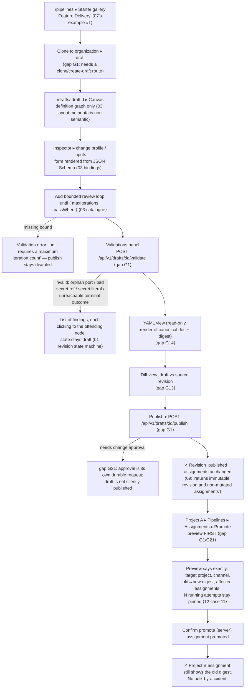
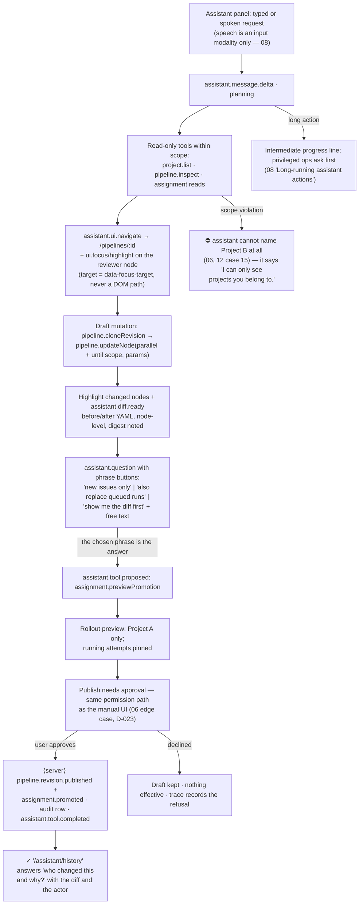
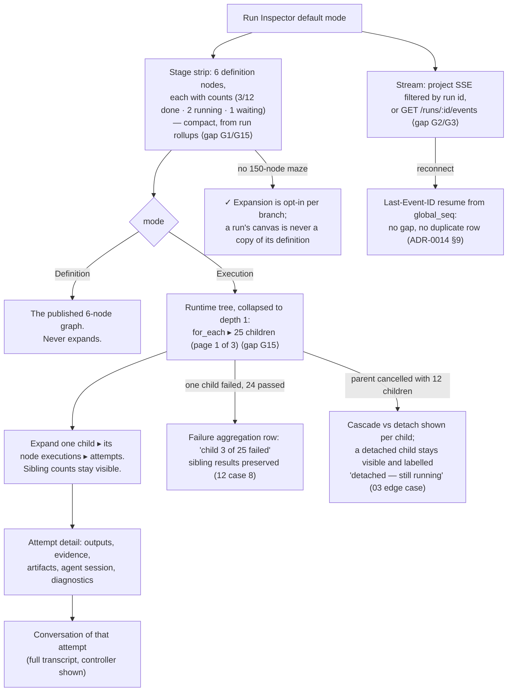
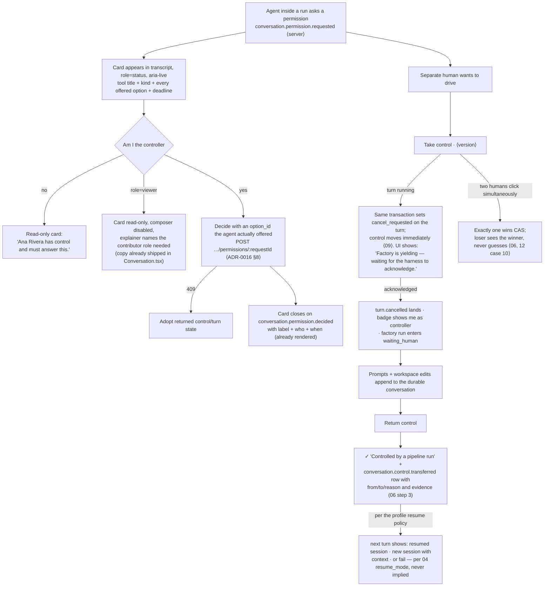
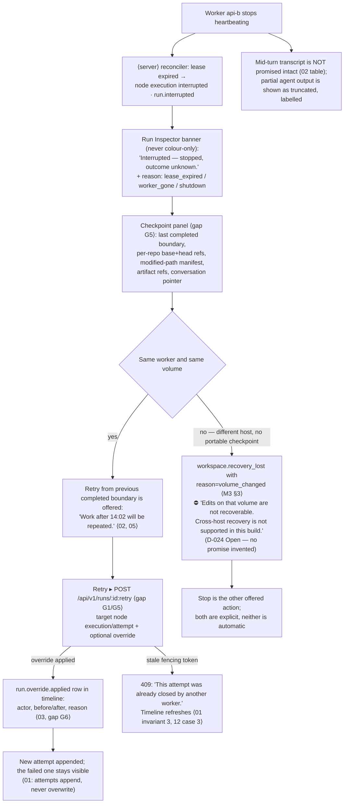
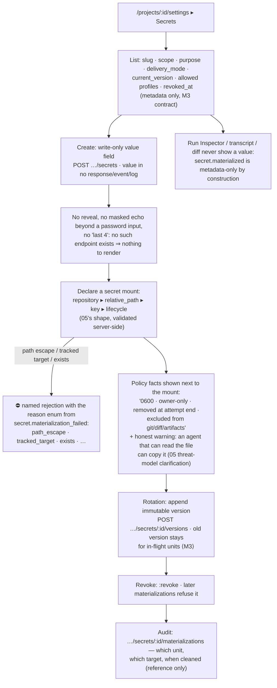
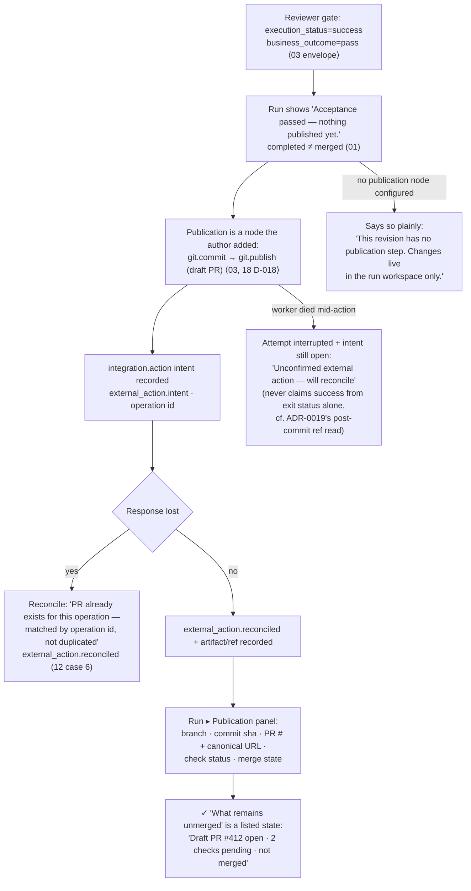

# User flows J1–J9 (with error and abort paths)

Journeys are named exactly as in `communication-spec/10-ui-design-handoff.md` "Key user journeys to
design completely". Every node below is either (a) an existing capability in
`api/openapi.yaml` / `docs/m3-contract.md`, or (b) tagged with a gap id from
[`README.md`](README.md) → *Contract gaps*. Diagrams are Mermaid `flowchart`s; state names are the
domain's (`01` "State machines"), never a UI-invented label.

Legend used in all diagrams:

| Marker | Meaning |
|---|---|
| `[server]` | authoritative state change the UI may only observe |
| `(409 …)` | conflict branch the UI must render, not swallow (ADR-0016 §9: adopt, don't retry) |
| ⛔ | hard stop: the screen explains what is missing and where to fix it (`10` J1) |
| ✓ | an acceptance point reused by [`acceptance-checklist.md`](acceptance-checklist.md) |

---

## J1 — First-run onboarding

*Admin connects OIDC (or approved dev auth), creates Project, adds two repositories, registers a
managed Claude/Codex launcher/profile, imports a starter pipeline, configures secrets, checks sandbox
status, launches the first run.*

There is no wizard object in the domain, so there is no wizard that fakes one: this is a **checklist
screen** whose items are each a real resource the admin can see, and whose completion state is read
from those resources — never stored as a "tutorial progress" field.

Error/abort paths designed:

| Condition | Screen behaviour | Source |
|---|---|---|
| IdP down mid-session | banner from `GET /api/v1/me` 401 → "read-only grace" copy; privileged actions disabled, transcript still readable | `06` "Identity provider unreachable", ADR-0012 |
| Non-admin tries to publish | no Publish button; explanation "Publishing needs a library role" (not a disabled mystery) | `01` authorization matrix |
| nono unavailable / kernel lacks restriction | run refuses to start; the failure names the stage (`probe,profile,policy_assert,grant_assert,exec,runtime`) and reason from `sandbox.enforcement_failed` | `docs/m3-contract.md` §3, `12` case 13 |
| APM target mismatch (profile's harness ≠ package target) | validation error on the draft/publish screen, not at run time only | `04` "APM preparation", gap G1 |
| No repositories yet | Starter clone is still allowed (draft is org-owned), but "Start run" is disabled with "Add at least one repository" | `05` workspace design |
| Duplicate create (no `Idempotency-Key` yet) | button disabled while pending; on a second submit the `409` explains it is a duplicate name, not a lost save | gap G24, ADR-0014 Consequences |

---

## J2 — New consultant assigned five projects

*Lands on attention dashboard; identifies two stalled runs, one human approval, three conversations;
opens the relevant client project without finding locally installed skills; takes control of a blocked
session, prompts, returns control.*

Designed detail: the consultant's screen never shows a path like `/var/lib/communication/…` (M3
contract forbids it) and never shows a skill list implying tenant isolation (D-025 **Open**).

---

## J3 — Pipeline author creates a workflow

*Selects sample Plan→Approve→Implement→Review; changes agent profiles/inputs; adds a bounded review
loop; validates; previews YAML/diff; publishes a new revision; promotes it to one Project only.*

Error/abort paths:

| Condition | Behaviour |
|---|---|
| Draft edited in another tab | draft `version` mismatch → "This draft changed elsewhere. Reload / keep my edits" (gap G12); never a silent overwrite |
| Graph edited after a run started | run screen header keeps the pinned digest and links the *revision*, not the draft (`03` edge case, `12` case 11) |
| Bindings reference a node that was deleted | validation finding with node id, not an index or canvas coordinate (`01` invariant 6) |
| Secret literal pasted into a node field | rejected by validation; message points to SecretRef picker (invariant 5, `03` step 1) |
| Review loop "never passes" | published graph is fine; the *run* fails at the declared bound with full evidence (`12` case 7) — the editor warns about unbounded loops before publish |
| Author lacks library role | Publish absent + explanation (`01` matrix "only with library role") |

---

## J4 — Natural-language authoring ("Use Gemini as reviewer for the beta of project A")

Rules the flow enforces: read-only inspection may proceed; draft edits may be applied with undo
history; publish/promote/secrets/security always ask (`08` "Tool action policy"). The assistant
creates drafts and **never deploys a workflow autonomously** (`08`).

---

## J5 — Live complex run (6 nodes → 25 children, hundreds of attempts)

---

## J6 — Permission request / handoff

---

## J7 — Failure / recovery (worker disappears)

Anti-patterns explicitly designed out: no "resumed without loss" copy, no auto-retry spinner that
hides a redo, no green check inherited from the killed attempt.

---

## J8 — Secret settings

---

## J9 — Publication

*Code review passes; branch/draft PR created as an explicit step; PR/status/commit linked; user can
identify what remains unmerged.*

---

## Cross-cutting error paths (every screen)

`10` "Empty and error states" lists these; each has one owned screen so the message is not written
twice in three dialects:

| Condition | Where surfaced | Copy rule |
|---|---|---|
| No repositories | Project Overview ▸ Repositories | names the next action (Add repository), not "empty" |
| No agent account / no profile | New-conversation form + Attention | "No agent profile you can launch. Ask an admin to register one." (gap G18) |
| nono kernel unavailable | `/ops`, run inspector banner, J1 checklist | stage + reason from the event; "no unprotected execution" (`05` gate) |
| APM target mismatch | draft validations + profile editor | "Package targets `codex`; this profile launches `claude`." |
| Disconnected worker | run inspector + `/ops/workers/:id` | "Worker api-b stopped reporting at 14:20. Nobody reported an outcome." |
| Missing portable checkpoint | retry dialog | "Cross-host recovery is not supported in this build." (D-024) |
| Expired worker lease | attempt detail + timeline | names the attempt and that its writes were rejected (12 case 3) |
| Missing permission | everywhere | 404-shaped: "not found or you do not have access" (ADR-0014 §3) — no 403 that leaks existence |
| Stream reconnecting | every live screen (`stream-status`) | "reconnecting — replaying from event 152007", plus replica name |
| Two prompts into one turn | composer | already-shipped explainer; button disabled, reason stated |
