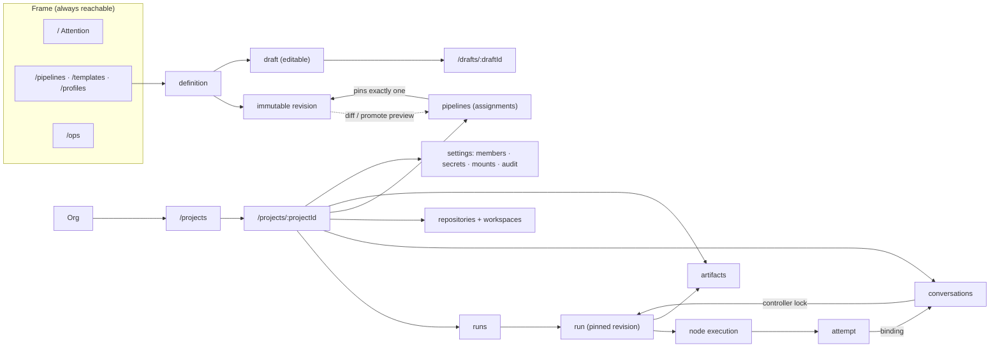

# Sitemap and entity-navigation model

Design ownership: layout, labels, progressive disclosure, navigation. Not ownership: state machines,
scheduling, protocol, auth, storage (`10` "Independence boundary").

## What already ships, and why it stays

`ui/src/App.tsx` today registers `/login`, `/`, `/projects/:projectId`,
`/projects/:projectId/conversations/:conversationId`, `/ops`, `*`. Every one of these survives M5
unchanged as a *prefix*: deep links, Playwright proofs (ADR-0006) and other people's bookmarks are
real users' expectations. M5 adds children under those prefixes rather than renaming them.

| Existing route | M5 status | Reason |
|---|---|---|
| `/login` | unchanged | OIDC + dev login already proven (ADR-0012) |
| `/` | **retargeted** to the Attention view for signed-in users; Projects list moves to `/projects` | `00` principle: work awareness first ("what needs my attention?"). The M1 exit proof only needs "see consistent state across replicas", which `/projects` satisfies equally |
| `/projects/:projectId` | unchanged; becomes project **Overview** (tab container) | `10` project-detail tab list |
| `/projects/:projectId/conversations/:conversationId` | unchanged | M2's transcript page is the reference implementation of the controller rules; M5 extends it, never forks it |
| `/ops` | unchanged prefix; gains `/ops/workers/:workerId`, `/ops/compatibility`, `/ops/secrets-audit` | `10` "Admin/Operations" |
| `*` NotFound | unchanged | problem-shaped, no data hints (ADR-0014 §3: existence is project-scoped information) |

Preserved UI conventions, from the existing code, treated as design rules from now on:

- Status is **written in words** next to any icon (`Operations.tsx` `StatusCard`,
  `Transcript.tsx` "status: awaiting a decision", `Project.tsx` "role: …"). Never colour-only
  (`10` Accessibility).
- `data-testid` remains on every interactive element and every list container; new screens follow the
  existing naming style (`<entity>-list`, `<entity>-row-<slug>`, `<verb>-<thing>`), because tests and
  the browser proofs are written against them.
- Replica badge stays in the footer (`replica.ts`, `X-Communication-Replica`) — it is the M1/M2
  multi-replica proof, and M5's run/timeline screens depend on it when a stream reconnects.
- `404` is rendered as "not found **or you do not have access**" (`Project.tsx`,
  `Conversation.tsx`). Every new project-scoped screen copies that copy verbatim; no screen ever
  distinguishes "missing" from "forbidden".

## Level 0 — Global frame

```
┌──────────────────────────────────────────────────────────────────────────────────┐
│ Communication   [Attention] [Projects] [Library]      ⟩ org · user ▾   [Sign out] │
├──────────────────────────────────────────────────────────────────────────────────┤
│                                                                                  │
│   page content (max-w container; run/editor pages opt into a wider shell)        │
│                                                                                  │
├──────────────────────────────────────────────────────────────────────────────────┤
│ replica: api-b · schema v4 · 2 open approvals · [?] keyboard shortcuts            │
└──────────────────────────────────────────────────────────────────────────────────┘
```

- **Assistant** is not a nav item: it is a persistent right panel, toggled with a button and `Ctrl/Cmd+K`
  (`08` "global context-aware panel"). Collapsed by default on <1280px (see responsive rules).
- Org switcher is a **display** chip, not a switcher, until multi-org exists: today
  `Organization` is seeded as a single `default` org (`api/openapi.yaml`), and `GET /api/v1/me`
  returns one organization. Showing a switcher with one entry teaches a false capability
  (`10` "buttons disabled/explained when unsupported" is the same discipline applied to chrome).
  **Open UX choice:** when multi-org lands, switcher replaces the chip in place.
- Operational health indicator in the frame shows only `health`/`readiness`/`workers` facts it can
  read (`/api/v1/system/health`, `/api/v1/system/readiness`, `/api/v1/workers`), and links to `/ops`.
  It never renders "degraded" from a client-side guess.
- The footer's "2 open approvals" count comes from the same source as `/inbox` (gap **G7/G16**);
  if that endpoint is not built, the footer omits the count rather than estimating.

## Level 1 — Route map

```
/login                                  existing
/                                       Attention (inbox)                ← signed-in default
/projects                               Projects index (moved from /)
/projects/new                           Create project (was an inline form on /)
/projects/:projectId                    Project ▸ Overview        [tab]
/projects/:projectId/work               Work / Queue              [tab]  (later: external refs, M6 — see note)
/projects/:projectId/runs               Runs list                 [tab]
/projects/:projectId/runs/:runId        Run Workbench             (deep; tabs Graph · Timeline · Execution tree · Diagnostics — see URL-state note)
/projects/:projectId/runs/:runId/nodes/:nodeExecutionId          Node Execution detail
/projects/:projectId/runs/:runId/attempts/:attemptId             Attempt detail (evidence)
/projects/:projectId/conversations      Conversations             [tab] (component exists; list takes ?q=<text> & origin=manual|run)
/projects/:projectId/conversations/:conversationId                Conversation (unchanged URL)
/projects/:projectId/repositories       Repositories + workspaces [tab]
/projects/:projectId/pipelines          Pipelines: assignments     [tab]
/projects/:projectId/artifacts          Artifacts                 [tab]
/projects/:projectId/settings           Settings: members, secrets, secret mounts, sandbox policy, audit
/pipelines                              Pipeline Library            (org-owned: definitions, revisions, drafts)
/pipelines/:pipelineId                  Definition ▸ revisions list
/pipelines/:pipelineId/revisions/:digest Revision viewer (immutable)
/drafts/:draftId                        ~~Pipeline Editor~~ — **replaced by Workflow Studio** (below); the URL shape still works and redirects
/templates                              Node template library
/profiles                               Agent profile library
/assistant/history                      Assistant action trace (durable list of past turns/actions)
/ops                                    Operations (existing prefix)
/ops/workers/:workerId                  Worker detail (leases, sandbox verdict, volume identity)
/ops/compatibility                      ACP / APM / sandbox compatibility (reads docs-fed data; gap G19)
/ops/secrets-audit                      Materializations by reference
/artifacts/:artifactId                  Artifact detail (metadata + content or attachment; preview frame)
/approvals/:approvalId                  Approval detail (durable human gate; gap G7)
*                                       NotFound (existing)
```

### Issue #2 additions (shipped — Studio, Workbench, New menu)

The table above is the M5 plan; these routes are what `ui/src/App.tsx` actually registers
after issue #2 (design checkpoint `studio-workbench.md`; ADR-0042/0043/0044). Top nav
relabels `/library` as **Workflows** (`Shell.tsx`) and carries a global **`New ▾` menu**
(`components/NewMenu.tsx`, testids `new-menu`, `new-menu-list`, `new-menu-conversation` /
`new-menu-workflow` / `new-menu-run`): *New conversation* (shared
`NewConversationDialog`, project picker required), *New workflow* (→ `/library` new-draft
flow), *Start run*. The project header repeats the two relevant entries — `project-new-conversation`
and `project-start-run` (`Project.tsx`).

| Route / state | Purpose |
|---|---|
| `/library/:pipelineId/drafts/:draftId` | **Workflow Studio** (lazy route, `StudioPage`): palette · React Flow canvas · schema-driven inspector · YAML view · diff · validations · save/validate/publish; header testids `studio-header`, `studio-title`, `studio-draft-version`, `studio-save`, `studio-validate`, `studio-diff`, `studio-publish`, views `studio-view-canvas` / `studio-view-yaml` |
| `/library/:pipelineId?draft=<draftId>` and the old `/drafts/:draftId` shape | **Redirect only**: replace-navigates to the Studio route, then the query string is dropped (`Library.tsx`); deep links written before issue #2 keep working |
| `/projects/:projectId/runs/:runId?view=…` | **Run Workbench** tabs, URL state `?view=graph|timeline|tree|diagnostics` · `node=<definitionNodeId>` · `instance=<nodeExecutionId>` · `attempt=<n>` · `scopes=<defKey>=<n>[,…]` (ADR-0043 §6; `?view` derives the tab, so selection is a shareable permalink). Legacy `?tab=definition|execution|timeline` links map onto `graph|tree|timeline` (`readWorkbenchView`); tab testids `run-tab-*` |
| `/projects/:projectId/conversations?q=…&origin=…` | Conversation list search + Manual / From-runs filter travel in the query string, so a filtered list is linkable; origin badges `conversation-origin-manual` / `conversation-origin-run`, filters `conversation-filter-manual` / `conversation-filter-run`, search `conversation-search` |

Navigation rules these additions must not break: the Studio canvas is the *only* editor
surface — the old inline YAML draft editor (`DraftEditor`) is gone, and the Workbench graph
is strictly read-only (editing from a run goes through `run-new-draft`, a *new* draft in the
Studio, never a mutation of the pinned revision). The old inspector's content is preserved
as the Workbench's `Diagnostics` tab (ADR-0043 §5); no testid was removed.

Tabs are real routes (not local state): a stalled run must be linkable into Slack/a PR comment and
reopen in the same shape, and `06` requires that "who changed this and why" is answerable from a
link. Tab strip is an ARIA `tablist` only where panels share scroll context; otherwise it is a nav
list (see `components.md` → `Tabs`).

**`/projects/:projectId/work` note.** `00` refuses a second issue tracker and `01` defines *Work Item
Reference* as external metadata (M6 adapter). In M5 the tab exists but shows only: runs queued for
this project, runs waiting on a human, and (when M6 lands) work-item references. It never becomes an
editable backlog: `Work Item Reference` has no create/update route, so an editable queue would be a
second tracker (D-001 principle 1). Rendering it as a filter of `runs?state=…` keeps the promise.

## Level 2 — Entity-navigation model

The navigation spine follows `01`'s principal relationships exactly; no screen invents a shortcut
across a boundary the domain does not allow.



Navigation rules that fall out of the domain and must not be broken by convenience:

1. **A run never navigates "through" its assignment to a newer revision.** The run header shows
   `revision <digest> (pinned)` linking to `/pipelines/:id/revisions/:digest`, with the assignment as
   a separate, secondary link. Editing a graph after a run started must not visually move the run
   (`01` ownership rule; `12` case 11).
2. **A draft is not a revision.** `/drafts/:draftId` has no URL that implies it can be *assigned*;
   `publish` produces a revision id, and only revision ids appear in assignment screens (`01`
   revision state machine; `10` "Draft edits are not published until authorized").
3. **Publish and promote are separate journeys with separate confirmation copy.** Publishing creates
   an immutable revision and changes no assignment (`09` "returns immutable revision and
   non-mutated assignments"); promotion is its own action, per project, with a preview (gap **G21**).
4. **A conversation carries its owner, not its location.** Control is rendered from
   `control.kind/user_id/display_name/version` (ADR-0016). When `kind=run_attempt` the screen says
   "Controlled by a pipeline run" (already implemented in `Conversation.tsx` `controllerCopy`) and,
   per M4 gap **G8**, links out to the run attempt rather than hiding the fact.
5. **Nothing cross-project unless the server enumerated it.** Autocomplete/assistant search results
   come from permission-filtered routes only; a project the user cannot see is not named in a
   message, a "did you mean", or an error (D-010, `12` case 15, ADR-0014 §3).
6. **Artifacts have one route and one origin rule.** Content for `standard|internal`; metadata-only
   rows for `restricted`; `secret` never listed (`ADR-0020` §3). HTML preview is an `<iframe>` whose
   `src` is the server-supplied absolute `preview_url` on the separate origin, never a path on the
   app origin (gap **G22**, `10` "never execute untrusted HTML as the app's origin").
7. **Secret screens never render a value** — no masked, "last 4" or admin reveal exists server-side
   (`docs/m3-contract.md` §2 "Deliberately absent"), so the UI has nothing to leak and must not offer
   a placeholder that implies one.
8. **Worker identity is a fact, not a link collection.** `/ops/workers/:workerId` shows leases and
   sandbox verdict; the browser never learns host paths (`root_path`/`mirror_path`/`admin_dir` are
   excluded server-side per `docs/m3-contract.md` §2) so no screen ever displays or links to one.

## Level 3 — In-screen navigation patterns

| Pattern | Where | Rules |
|---|---|---|
| **Attention-first ordering** | `/`, project Overview | Anything in `waiting_human`, `interrupted`, `failed`, or an unanswered approval sorts above routine rows, and is labelled with the reason ("waiting 3d 4h for approval"), not just a colour |
| **Progressive disclosure, never hidden prerequisites** | J1 setup, profile/sandbox status | A blocked step names what is missing and where to fix it (`10` J1: "Errors and prerequisites should not be hidden"): "nono unavailable on worker api-b → see `/ops/workers/w-1`" |
| **Contextual "back to owner"** | Run inspector, artifact detail, attempt detail | Breadcrumb to project ▸ runs ▸ run, plus a "Related" rail (conversation, workspace, artifacts, source revision) since `01` links these laterally |
| **Stable deep links** | every detail screen | Id-based URLs; no screen is reachable only by clicking through a live stream. `event.global_seq` appears in a "jump to event" permalink (`09` lineage) |
| **Definition vs runtime toggle** | Run inspector | Two explicitly named modes ("Definition" / "Execution") — `03` insists they are different objects; one canvas never tries to draw both |
| **Focus/highlight target** | Assistant | `ui.focus`/`ui.highlight` address a stable `data-focus-target` attribute (screen-owned), never a CSS selector or DOM path (`08`: presentation of an already-authorized state) |
| **Escape hatch** | everywhere | `Esc` closes the assistant, drawers and popovers without losing page scroll; deep-link URLs are unaffected |

## Screen inventory (what M5 must contain)

Drawn from `10` "Requested output" items 1–4 and `11` M5's bullet list:

1. `/` Attention (inbox) — stalled/blocked runs, open approvals, conversations needing a decision,
   recent failures, feed health.
2. `/projects` index + `/projects/new`.
3. Project Overview — activity feed (exists), runs summary, conversations (exists), artifacts,
   assignment chips, workspace/sandbox health for this project.
4. Runs list → **Run Inspector**: definition graph view, expanded runtime execution tree, timeline,
   attempts, loops, child runs, artifacts, source revision, human interactions.
5. Node execution detail → **Attempt detail**: typed outputs, raw/output view, evidence, diagnostics,
   retry/override affordance (gap **G4/G5**).
6. **Pipeline Library**: searchable starter gallery + org definitions + drafts + stable/beta channels;
   node-template library; agent-profile library.
7. **Pipeline Editor**: canvas, node palette, detail inspector (schema-driven form), parameters,
   validations, revision diff, publish/promotion controls, YAML view.
8. **Conversation** (extend existing): human + factory-run presentation, workspace widget, relevant
   run node, permission prompts, takeover/return, transcript streaming-rate control.
9. **Assistant panel** + `/assistant/history` (typed action trace).
10. **Operations**: workers, sandbox health (`GET /system/sandbox` in the M3 contract), lease/queue
    health, compatibility table, identities/credentials metadata, audit, rate limits (gap **G19**).
11. Secrets settings (J8): secret metadata, versions, allowlists, secret mounts, materialization
    audit — no raw values anywhere.
12. Artifact detail + sandboxed preview surface.
13. Approval detail (durable human gate; gap **G7**).

## Open UX choices (designer decides later, no ADR needed)

- Whether Attention and Projects index merge on small screens (leaning: merge — one list with a
  "needs attention" filter).
- Whether the assistant panel is a right dock or a bottom sheet at 768–1100px (leaning: bottom sheet,
  because the run tree needs width).
- Whether `/templates` and `/profiles` are top-level nav items or Library sub-tabs (leaning: sub-tabs;
  five nav items dilute the two that matter, Attention and Projects).
- Copy voice: current code says "Return control", "Take control", "Stop" — keep these exact strings
  product-wide; they are already in tests and are the best wording found.
